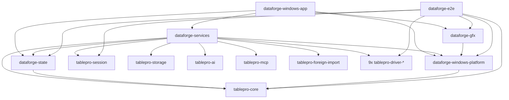

# DataForge Architecture

DataForge is organized as a Cargo workspace combining the platform-agnostic TablePro database engine (`core/crates/*`) with six Windows-native crates (`crates/dataforge-*`).

## Crate Dependency Graph



| Crate | Responsibility |
| --- | --- |
| `dataforge-windows-platform` | Win32 Credential Manager, Named Pipe IPC, Registry theme/machine-ID, KnownFolders paths, foreign app discovery |
| `dataforge-state` | Headless deterministic state machines: connection phases, data grid, SQL editor, tab strip, library, themes |
| `dataforge-gfx` | Direct3D 11 + DXGI + Direct2D/DirectWrite GPU rendering, virtualized grid/editor renderers, 11 adaptive vector glyphs |
| `dataforge-services` | `AppRuntime`, `SessionManager`, `DriverRegistry`, atomic export, import bridge, MCP host, AI assistant, diagnostics |
| `dataforge-windows-app` | Win32 window shell, Per-Monitor DPI v2, UIA baseline, keyboard shortcuts, workbench views, modal dialogs |
| `dataforge-e2e` | End-to-end integration tests across drivers, SQLite/DuckDB, foreign import, state/gfx/platform, startup, and containers |

## Core vs. Windows Shell Separation

1. **`core/crates/*` (TablePro Engine)**: Remains strictly cross-platform and unmodified by DataForge UI changes. Exposes `DatabaseDriver`, `Session`, `DriverConnector`, `SecretVault`, `StoragePaths`, `ResultSink`, `ForeignImport`, `AiAssistant`, and `McpServer`.
2. **`crates/dataforge-state`**: Mirrors UI-facing state machines in pure Rust with zero Win32 or GPU dependencies, enabling deterministic unit testing of every transition without creating an HWND.
3. **`crates/dataforge-windows-platform`**: Implements TablePro platform traits (`SecretVault` via `WindowsCredentialStore`, `ForeignHost` via `ForeignPlatform`, `CliHost` via `WindowsCliHost`) and Windows-specific IPC/Registry seams.
4. **`crates/dataforge-gfx`**: Owns Direct3D 11 / DXGI / Direct2D / DirectWrite device resources and translates `dataforge-state` models + `ThemePalette` into GPU draw calls.

## Runtime & Session Lifecycle

```text
Win32 UI Thread (MainWindow / AppController)
   │  dispatches user intents & polls non-blocking updates
   ▼
dataforge-services::AppRuntime (Tokio multi-thread runtime)
   │  owns DriverRegistry (9 drivers), SessionManager, McpServerController
   ▼
tablepro-session::Session (per-connection actor + HealthMonitor)
   │  DriverConnector -> InProcessSsh / TLS -> DatabaseDriver
   ▼
ResultSink / RunEventAccumulator -> dataforge-state -> dataforge-gfx
```

- **Cancellation & Attempt Fencing**: Every connection attempt carries an `attempt_token` (`u64`) and `CancellationToken`; late completions from superseded attempts are discarded cleanly.
- **Health & Reconnect**: `tablepro-session` monitors connection liveness (`LivenessPolicy::DESKTOP`) and surfaces `ConnectionUnavailableView` in `ConnectionWindowPhaseMachine` with retry/edit/disconnect actions.
- **Safe Mode & Open Transactions**: `SafeModeLevel` and open-transaction guards gate destructive SQL, row commits, and tab/window close flows.

## Lint Policy & Testing Strategy

The workspace enforces strict reliability rules in `Cargo.toml` (`[workspace.lints]`):
- `unsafe_op_in_unsafe_fn = "deny"`
- `unwrap_used`, `expect_used`, `panic`, `todo`, `unimplemented`, `too_many_lines`, `print_stdout`, `print_stderr` = `"deny"` (with test exemptions configured in `clippy.toml`).
- `disallowed_types` / `disallowed_methods` prevent key-reordering JSON maps (`serde_json::Map`) and stack-overflowing BSON cursor deserialization.

## Detailed Technical Guides

- [State Machines](docs/state-machines.md) — `ConnectionWindowPhaseMachine`, `DataGridModel`, `EditorModel`, `TabStripModel`, `LibraryModel`, and `ThemeResolver`.
- [Platform Seams](docs/platform-seams.md) — Windows Credential Manager, Named Pipe IPC, Registry theme/machine-ID, `StoragePaths`, and foreign app discovery.
- [Rendering Pipeline](docs/rendering-pipeline.md) — Win32 + Direct3D 11 + Direct2D/DirectWrite pipeline, virtualized grid/editor rendering, and adaptive vector glyphs.
