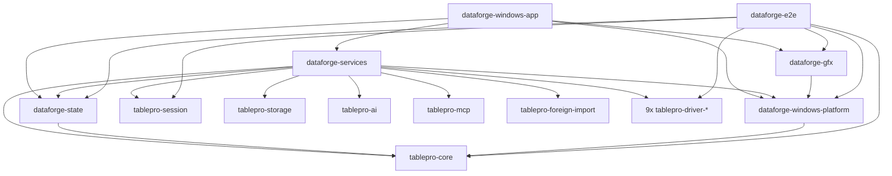

# DataForge Architecture

DataForge is organized as a Cargo workspace combining the platform-agnostic TablePro database engine (`core/crates/*`) with six Windows-native crates (`crates/dataforge-*`).

## Crate Dependency Graph

| Crate | Responsibility |
| --- | --- |
| `dataforge-windows-platform` | Win32 Credential Manager, Named Pipe IPC, Registry theme/machine-ID, KnownFolders paths, foreign app discovery |
| `dataforge-state` | Headless deterministic state machines: connection phases, data grid, SQL editor, tab strip, library, themes |
| `dataforge-gfx` | Direct3D 11 + DXGI + Direct2D/DirectWrite GPU rendering, virtualized grid/editor renderers, 11 adaptive vector glyphs |
| `dataforge-services` | `AppRuntime`, `SessionManager`, `DriverRegistry`, atomic export, import bridge, MCP host, AI assistant, diagnostics |
| `dataforge-windows-app` | Win32 window shell, Per-Monitor DPI v2, UIA baseline, keyboard shortcuts, workbench views, modal dialogs |
| `dataforge-e2e` | End-to-end integration tests across drivers, SQLite/DuckDB, foreign import, state/gfx/platform, startup, and containers |
