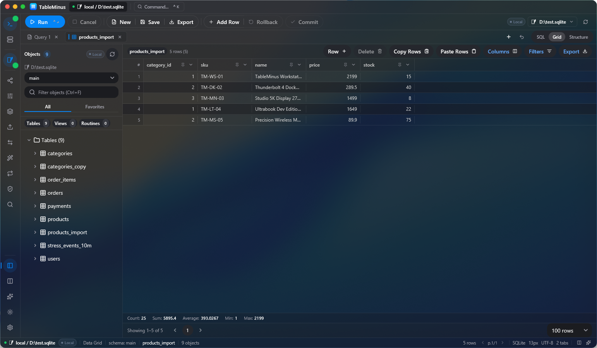
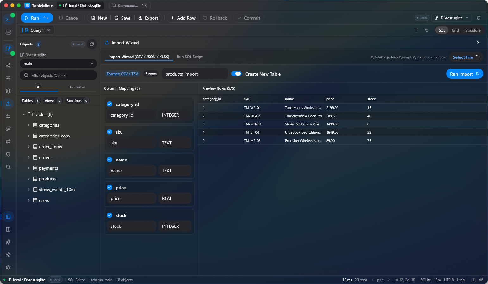
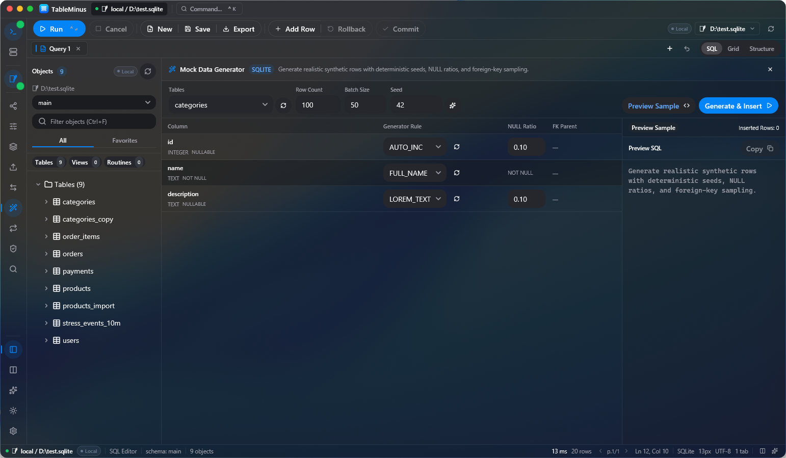

<div align="center">


# TableMinus

**Banco de trabajo SQL y de bases de datos nativo en Rust para Windows.**

[](https://github.com/williamcachamwri/TableMinus/actions/workflows/ci.yml)
[](https://github.com/williamcachamwri/TableMinus/actions/workflows/release.yml)
[](https://www.rust-lang.org/)
[](#descripción-general)
[](#bases-de-datos-compatibles)
[](#descripción-general)
[](#descripción-general)
[](#descarga-e-instalación)
[](LICENSE-MIT)

[English](README.md) · [Tiếng Việt](README.vi.md) · [简体中文](README.zh-CN.md) · [日本語](README.ja.md) · [Español](README.es.md) · [Français](README.fr.md)

</div>

---

## Descripción general

TableMinus es un cliente SQL y banco de trabajo de bases de datos nativo para Windows escrito en Rust. Renderiza la interfaz directamente sobre Direct3D 11 mediante [HeroGPUI](https://github.com/williamcachamwri/TableMinus) y se apoya en el núcleo abierto en Rust de [TablePro](https://github.com/TableProApp/TablePro), prescindiendo por completo de Electron y la JVM.

En compilaciones release sobre Windows 11, el arranque en frío ronda los `10 ms` (medido entre `9.21` y `10.11 ms` con `--smoke-startup` y los 9 controladores registrados), y el consumo de memoria se mantiene cerca de `~55 MB` durante consultas de estrés de `100k`, `500k` y `1M` filas. En la suite SQLite de `tableminus-e2e`, cargar `100k` filas en la cuadrícula lleva `24.43 ms` y desplazar `10k` fotogramas tarda `0.432 ms`.

---

## Capturas de pantalla

### Editor SQL, gráficos en vivo y resultados de consultas


### Cuadrícula virtualizada, agregados por columna y filtros parametrizados



### Diagrama ER interactivo, relaciones de clave foránea y exportación SVG


### Asistente de importación (CSV, JSON, XLSX) con mapeo automático de tipos



### Comparación de esquemas y datos con script de sincronización


### Generador de datos sintéticos con semillas deterministas y claves foráneas



### Transferencia de datos entre motores con vista previa DDL en vivo


### Búsqueda global de metadatos (Metadata Search)


### Panel de IA limitado al esquema (`Ctrl+Shift+A`)


---

## Bases de datos compatibles

TableMinus compila 9 controladores directamente dentro de `tableminus.exe`, sin necesidad de configurar ODBC ni instalar complementos externos:

| Base de datos | Crate del controlador | Notas |
| :--- | :--- | :--- |
| PostgreSQL | `tablepro-driver-postgres` | `tokio-postgres` + `deadpool`, `COPY IN`, inspección de esquemas y DDL |
| MySQL / MariaDB | `tablepro-driver-mysql` | Dialecto SQL completo y metadatos de catálogo |
| SQLite | `tablepro-driver-sqlite` | Archivos `.sqlite` / `.db` locales por apertura directa, arrastrar y soltar o CLI |
| DuckDB | `tablepro-driver-duckdb` | DuckDB 2.0 integrado con `json` y `parquet` compilados |
| Microsoft SQL Server | `tablepro-driver-mssql` | TDS 8.0 en Rust puro (`tiberius`) con TLS y lotes de múltiples resultados |
| ClickHouse | `tablepro-driver-clickhouse` | Consultas HTTP/TLS mediante `hyper-rustls` |
| Cassandra / ScyllaDB | `tablepro-driver-cassandra` | Controlador CQL nativo (`scylla`) sobre `rustls` |
| MongoDB | `tablepro-driver-mongodb` | Consultas de documentos, mapeo BSON 3 y resolución DNS seed list |
| Redis | `tablepro-driver-redis` | Inspección clave-valor y ejecución de comandos sobre TLS/TCP asíncrono |

Las conexiones admiten túneles SSH en proceso con `russh` (`tablepro-ssh` con contraseña, clave privada, solicitud de frase de paso y verificación de clave de host), TLS con `rustls` y el almacén de certificados de Windows (`Disable`, `Prefer`, `Require`, `VerifyCA`, `VerifyFull`, además de archivos CA, certificado y clave de cliente), políticas de Modo Seguro (`Off`, `ConfirmWrites`, `ReadOnly`) e importación de conexiones guardadas desde otros clientes mediante `tablepro-foreign-import`.

---

## Características

### Editor SQL y Cuadrícula de datos

El editor incluye resaltado de sintaxis por dialecto (`PostgreSQL`, `MySQL`, `SQLite`, `MsSql`, entre otros), autocompletado para tablas, columnas, esquemas, palabras clave y cláusulas SQL (`FROM`, `JOIN`, `INTO`, `UPDATE`), edición multicursor, biblioteca de consultas guardadas, historial persistente y modo Vim opcional (`NORMAL`, `INSERT`, `VISUAL`, `COMMAND`).

En la cuadrícula puedes revisar filas en el Row Inspector acoplado (`Ctrl+I`), alternar entre las pestañas Structure, Columns, Indexes, Foreign Keys y DDL, fijar columnas iniciales hasta 2/3 del ancho visible, ocultar o redimensionar columnas y apilar filtros parametrizados con 11 operadores (`=`, `!=`, `Contains`, `StartsWith`, `EndsWith`, `<`, `<=`, `>`, `>=`, `IS NULL`, `IS NOT NULL`). Las ediciones de celdas, inserciones (`Alt+Insert`) y eliminaciones (`Ctrl+Shift+Backspace`) se agrupan en lote hasta confirmar con `Commit` (`Ctrl+Shift+S`) o revertir con `Rollback` (`Ctrl+Shift+R`).

Los resultados y tablas se exportan de forma atómica mediante archivos temporales `.part` a CSV (`.csv`), JSON Array (`.json`), JSON Lines (`.jsonl`) o SQL `INSERT` (`.sql`) desde `Ctrl+Shift+E`. `tablepro-core` también incorpora codificadores para TSV, XML y XLSX de memoria constante.

### Seguridad y almacenamiento local

Las contraseñas de bases de datos, secretos SSH, claves de API para IA y tokens Bearer de MCP se guardan en el Administrador de credenciales de Windows (`CredWriteW` / `CredReadW`) y se limpian de la memoria con `zeroize`, sin escribirse en texto plano en archivos JSON ni registros. El Modo Seguro permite fijar cada conexión en `ConfirmWrites` o `ReadOnly` para pedir confirmación o bloquear `UPDATE`, `DELETE` y `DROP` antes de ejecutarlos.

### Asistente de IA y servidor MCP

El panel de IA (`Ctrl+Shift+A`) se conecta a una instancia local de Ollama (`http://127.0.0.1:11434/v1`), cualquier endpoint compatible con OpenAI, OpenAI o Anthropic. Al modelo solo se envían metadatos del esquema (nombres de tablas, columnas, tipos y dialecto SQL); las filas de la base de datos permanecen en tu equipo.

Para agentes de programación y editores externos, `tablepro-mcp` levanta un servidor MCP HTTP local en `127.0.0.1` protegido con un token Bearer en el Administrador de credenciales de Windows y verificación de proceso par. Expone 11 herramientas:

- `list_connections`, `connect`, `list_databases`, `list_schemas`, `list_tables`, `describe_table`, `get_table_ddl`, `browse_table`, `count_rows`, `execute_query` y `export_data`

`execute_query` respeta las reglas de Clientes Externos y Modo Seguro de cada conexión y solicita aprobación dentro de TableMinus antes de ejecutar cualquier escritura.

### Temas, fondos e idiomas

TableMinus incluye 14 temas integrados (`Dark`, `Light`, `High Contrast`, `Gaussian Glass Dark`, `Gaussian Glass Light`, `Tokyo Night`, `Dracula`, `Catppuccin Mocha`, `One Dark Pro`, `Nord`, `Monokai Pro`, `Gruvbox Dark`, `GitHub Light` y `Catppuccin Latte`). Puedes combinar el tema de interfaz y la paleta de sintaxis por separado, o importar temas de color `.json` de VS Code.

En Windows 11 la ventana principal admite los materiales DWM `Gaussian Blur`, `Mica`, `Mica Alt` y `Opaque`, manteniendo las capas flotantes totalmente opacas (`1.0` alpha) para conservar la legibilidad. La opción de movimiento reducido sigue `SPI_GETCLIENTAREAANIMATION` de Windows para omitir transiciones cuando las animaciones del sistema están desactivadas. Toda la interfaz, menús, diálogos, descripciones y diagnósticos de controladores están traducidos a 6 idiomas: `en-US`, `vi-VN`, `zh-CN`, `ja-JP`, `es-ES` y `fr-FR`.

### Uso por CLI

`tableminus.exe` funciona tanto como lanzador de escritorio como herramienta de línea de comandos (`tablepro-cli`). Si pasas rutas `.sqlite`, `.db`, `.duckdb`, `.sql` o URLs de conexión (`postgresql://...`), se abrirán en la instancia activa mediante Named Pipe IPC (añade `-n` / `--new-window` para abrir una ventana nueva).

Opciones principales:
- `--version` (`-V`) muestra la versión y sale.
- `--help` (`-h`) muestra la ayuda y opciones del CLI.
- `--smoke-startup` ejecuta una prueba de arranque sin ventana y comprueba el registro de los 9 controladores.

Subcomandos: `open`, `query`, `connections`, `databases`, `schemas`, `tables`, `describe`, `export`, `status` y `completion` (`bash`, `zsh`, `fish`), con banderas como `--format`, `--read-only`, `--limit` y `--timeout`.

```powershell
# Ejecutar una consulta de solo lectura y mostrarla en JSON Lines
.\target\release\tableminus.exe query -c Staging --read-only --format jsonl "SELECT id, email FROM users LIMIT 10"

# Mostrar la sentencia CREATE TABLE DDL de una tabla
.\target\release\tableminus.exe describe -c Staging --ddl users
```

---

## Descarga e instalación

Requiere **Windows 10 o Windows 11 (x64)**. Los binarios compilados se publican en [GitHub Releases](https://github.com/williamcachamwri/TableMinus/releases):

- **Instalador (`TableMinus-win-Setup.exe`)**: Se instala en `%LocalAppData%` con accesos directos en el menú Inicio y el escritorio sin pedir elevación UAC. Usa Velopack para actualizaciones delta en segundo plano configurables en **Settings -> About**.
- **Versión portable (`TableMinus-win-Portable.zip`)**: Descomprime en cualquier carpeta y ejecuta `tableminus.exe` directamente sin tocar el estado del instalador.

Cada lanzamiento incluye `SHA256SUMS.txt` para verificar la descarga desde PowerShell:

```powershell
Get-FileHash .\TableMinus-win-Setup.exe -Algorithm SHA256
```

---

## Atajos de teclado

| Atajo | Acción |
| :--- | :--- |
| `Ctrl+K` / `Ctrl+Shift+K` / `Ctrl+P` | Abrir paleta de comandos |
| `Ctrl+Enter` / `F5` | Ejecutar consulta SQL activa |
| `Ctrl+Shift+Enter` | Ejecutar el fragmento SQL seleccionado |
| `Shift+Esc` | Cancelar consulta en ejecución |
| `Ctrl+S` | Guardar consulta en la biblioteca |
| `Ctrl+T` / `Ctrl+W` / `Ctrl+Shift+T` | Nueva pestaña / Cerrar pestaña / Reabrir pestaña cerrada |
| `Ctrl+Tab` / `Ctrl+Shift+Tab` | Pestaña siguiente / anterior |
| `Ctrl+F` | Enfocar filtro de objetos en la barra lateral |
| `Ctrl+B` | Mostrar u ocultar barra lateral de objetos |
| `Ctrl+I` | Mostrar u ocultar Row Inspector |
| `Ctrl+Shift+A` | Mostrar u ocultar panel de IA |
| `Ctrl+Shift+O` | Abrir biblioteca de conexiones |
| `Ctrl+,` | Abrir Configuración |
| `Ctrl+Shift+M` | Cambiar de tema |
| `Ctrl+Shift+S` / `Ctrl+Shift+R` | Confirmar (`Commit`) / Revertir (`Rollback`) cambios en la cuadrícula |
| `Alt+Insert` / `Ctrl+Shift+Backspace` | Añadir fila / Eliminar filas seleccionadas |
| `Ctrl+Shift+E` | Exportar resultados o tabla |
| `Esc` | Cerrar modal o panel flotante activo |

La navegación Vim (`NORMAL`, `INSERT`, `VISUAL` y comandos `:`) puede activarse desde la barra del editor SQL.

---

## Compilar desde el código fuente

### Requisitos previos

- Windows 10 o Windows 11 (x64)
- Toolchain estable de Rust para MSVC (`x86_64-pc-windows-msvc`, Rust `2024` Edition) vía [rustup](https://rustup.rs/)
- Visual Studio C++ Build Tools y Windows SDK (para Win32, Direct3D 11 y los controladores C integrados)
- Windows PowerShell (usa `;` en lugar de `&&` para encadenar comandos)

> [!CAUTION]
> Compila y ejecuta pruebas siempre con `--release`. Evita ejecutar `cargo build` o `cargo test` en modo debug sobre todo el workspace salvo que necesites depurar símbolos concretos, ya que los archivos PDB en `target\debug` para todos los crates y los 9 controladores superan los 140 GB. Añade `-j 1` en equipos con poca RAM.

### Comandos de compilación y pruebas

```powershell
# Comprobar que ningún proceso tableminus.exe esté bloqueando target\release\tableminus.exe
Get-Process tableminus -ErrorAction SilentlyContinue

# Verificar tipos y compilar el binario release
cargo check --release -j 1 -p tableminus-windows-app
cargo build --release -j 1 -p tableminus-windows-app

# Ejecutar la verificación de arranque e iniciar la aplicación
.\target\release\tableminus.exe --smoke-startup
.\target\release\tableminus.exe
```

Pruebas en modo release:

```powershell
cargo test --release -j 1 -p tablepro-core filter
cargo test --release -j 1 -p tableminus-e2e --test startup_perf_e2e -- --nocapture
cargo test --release -j 1 -p tableminus-e2e --test sqlite_e2e -- --nocapture
```

### Estructura del workspace

| Ruta | Función |
| :--- | :--- |
| `core/crates/core` | `tablepro-core`: modelos de consulta, filtros, dialectos SQL y exportación |
| `core/crates/session` | `tablepro-session`: sesiones activas, pools de conexión y transacciones |
| `core/crates/cli` | `tablepro-cli`: subcomandos CLI y ejecución sin interfaz |
| `core/crates/mcp` | `tablepro-mcp`: servidor MCP HTTP local autenticado con token |
| `core/crates/ai` | `tablepro-ai`: cliente Ollama, OpenAI y Anthropic limitado al esquema |
| `core/crates/ssh` | `tablepro-ssh`: túneles SSH en proceso mediante `russh` |
| `core/crates/net` | `tablepro-net`: TLS con `rustls` y verificación de certificados del sistema |
| `core/crates/storage` | `tablepro-storage`: conexiones guardadas, biblioteca de consultas e historial |
| `core/crates/foreign-import` | `tablepro-foreign-import`: importación desde otros clientes de bases de datos |
| `core/crates/account` | `tablepro-account`: traits de cuentas y tokens |
| `core/crates/drivers/*` | 9 controladores (`postgres`, `mysql`, `sqlite`, `duckdb`, `mssql`, `clickhouse`, `cassandra`, `mongodb`, `redis`) |
| `crates/tableminus-gfx` | Glifos vectoriales e iconos de motores |
| `crates/tableminus-state` | Estado del editor, autocompletado, modelo de cuadrícula, pestañas y 14 temas |
| `crates/tableminus-services` | Runtime asíncrono Tokio, orquestación de sesión/IA/MCP y diagnósticos |
| `crates/tableminus-windows-platform` | Ajustes JSON, Administrador de credenciales Win32, DWM y movimiento reducido |
| `crates/tableminus-windows-app` | Aplicación de escritorio HeroGPUI (Direct3D 11), actualizador Velopack y 6 idiomas |
| `crates/tableminus-e2e` | Benchmarks de SQLite, DuckDB, arranque y rendimiento de cuadrícula |

---

## Contribuciones y licencia

Se aceptan contribuciones, reportes de errores y mejoras de traducción. Consulta [CONTRIBUTING.md](CONTRIBUTING.md) para las reglas de compilación y GPUI, [CHANGELOG.md](CHANGELOG.md) para el historial de versiones, [CODE_OF_CONDUCT.md](CODE_OF_CONDUCT.md) y [SECURITY.md](SECURITY.md) para reportar vulnerabilidades en privado.

TableMinus se distribuye bajo [LICENSE](LICENSE) (GNU Affero General Public License v3.0) y [LICENSE-MIT](LICENSE-MIT) (MIT, con atribución al núcleo base de [TableProApp/TablePro](https://github.com/TableProApp/TablePro)).
