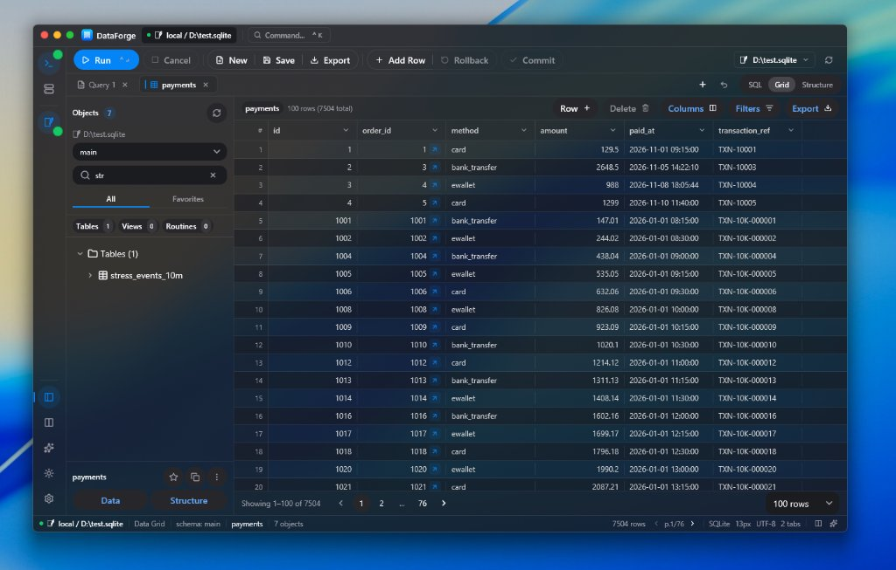

<div align="center">


# DataForge

**Atelier SQL et bases de données natif en Rust pour Windows.**

[](https://github.com/williamcachamwri/DataForge/actions/workflows/ci.yml)
[](https://github.com/williamcachamwri/DataForge/actions/workflows/release.yml)
[](https://www.rust-lang.org/)
[](#présentation)
[](#bases-de-données-prises-en-charge)
[](#présentation)
[](#présentation)
[](#téléchargement-et-installation)
[](LICENSE-MIT)

[English](README.md) · [Tiếng Việt](README.vi.md) · [简体中文](README.zh-CN.md) · [日本語](README.ja.md) · [Español](README.es.md) · [Français](README.fr.md)

</div>

---

## Présentation

DataForge est un atelier SQL et gestionnaire de bases de données natif pour Windows écrit en Rust. L'interface s'appuie sur [HeroGPUI](https://github.com/williamcachamwri/DataForge) directement au-dessus de Direct3D 11 et réutilise le cœur Rust open source de [TablePro](https://github.com/TableProApp/TablePro), sans Electron ni JVM.

Sur Windows 11 avec une compilation release, le démarrage à froid prend environ `10 ms` (mesuré entre `9.21` et `10.11 ms` via `--smoke-startup` avec les 9 pilotes enregistrés) et la mémoire du processus reste autour de `~55 Mo` lors de requêtes intensives sur `100k`, `500k` et `1M` lignes. Dans la suite SQLite `dataforge-e2e`, le chargement de `100k` lignes dans la grille prend `24.43 ms` et le défilement sur `10k` images prend `0.432 ms`.

---

## Captures d'écran

### Éditeur SQL, mode Vim et panneau de résultats partagé (requête indexée en `15 ms` sur 10M lignes)


### Grille de données virtualisée, inspecteur de structure et filtres paramétrés



### Volet IA limité au schéma (`Ctrl+Shift+A`)


---

## Bases de données prises en charge

DataForge compile 9 pilotes directement dans `dataforge.exe`, sans pilote ODBC externe ni extension à installer :

| Base de données | Crate du pilote | Notes |
| :--- | :--- | :--- |
| PostgreSQL | `tablepro-driver-postgres` | `tokio-postgres` + `deadpool`, `COPY IN`, inspection de schéma et DDL |
| MySQL / MariaDB | `tablepro-driver-mysql` | Dialecte SQL complet et métadonnées du catalogue |
| SQLite | `tablepro-driver-sqlite` | Ouverture de fichiers `.sqlite` / `.db` locaux par dialogue, glisser-déposer ou CLI |
| DuckDB | `tablepro-driver-duckdb` | DuckDB 2.0 embarqué avec `json` et `parquet` liés |
| Microsoft SQL Server | `tablepro-driver-mssql` | TDS 8.0 pur Rust (`tiberius`) avec TLS et lots multi-résultats |
| ClickHouse | `tablepro-driver-clickhouse` | Requêtes HTTP/TLS via `hyper-rustls` |
| Cassandra / ScyllaDB | `tablepro-driver-cassandra` | Pilote CQL natif (`scylla`) sur `rustls` |
| MongoDB | `tablepro-driver-mongodb` | Requêtes document, mappage BSON 3 et résolution DNS seed list |
| Redis | `tablepro-driver-redis` | Inspection clé-valeur et exécution de commandes sur TLS/TCP asynchrone |

Les connexions gèrent le tunnel SSH intégré via `russh` (`tablepro-ssh` avec mot de passe, clé privée, invite de phrase secrète et vérification de clé d'hôte), le TLS via `rustls` et le magasin de certificats Windows (`Disable`, `Prefer`, `Require`, `VerifyCA`, `VerifyFull`, plus CA et certificat/clé client personnalisés), les politiques Safe Mode (`Off`, `ConfirmWrites`, `ReadOnly`), ainsi que l'import de connexions depuis d'autres clients via `tablepro-foreign-import`.

---

## Fonctionnalités

### Éditeur SQL et Grille de données

L'éditeur propose la coloration syntaxique par dialecte (`PostgreSQL`, `MySQL`, `SQLite`, `MsSql`, etc.), l'autocomplétion des tables, colonnes, schémas, mots-clés et clauses SQL (`FROM`, `JOIN`, `INTO`, `UPDATE`), l'édition multi-curseur, une bibliothèque de requêtes enregistrées, un historique persistant et un mode Vim optionnel (`NORMAL`, `INSERT`, `VISUAL`, `COMMAND`).

Dans la grille, vous pouvez examiner chaque ligne dans le Row Inspector ancré (`Ctrl+I`), basculer entre les onglets Structure, Columns, Indexes, Foreign Keys et DDL, figer les premières colonnes jusqu'aux 2/3 de la largeur, masquer ou redimensionner les colonnes et empiler des filtres paramétrés avec 11 opérateurs (`=`, `!=`, `Contains`, `StartsWith`, `EndsWith`, `<`, `<=`, `>`, `>=`, `IS NULL`, `IS NOT NULL`). Les modifications de cellules, ajouts de lignes (`Alt+Insert`) et suppressions (`Ctrl+Shift+Backspace`) restent en attente par lot jusqu'au `Commit` (`Ctrl+Shift+S`) ou au `Rollback` (`Ctrl+Shift+R`).

Les résultats et tables s'exportent de manière atomique via des fichiers temporaires `.part` en CSV (`.csv`), JSON Array (`.json`), JSON Lines (`.jsonl`) ou SQL `INSERT` (`.sql`) avec `Ctrl+Shift+E`. `tablepro-core` embarque aussi des encodeurs TSV, XML et XLSX à mémoire constante.

### Sécurité et stockage local

Les mots de passe de bases de données, secrets SSH, clés API IA et jetons Bearer MCP sont enregistrés dans le Gestionnaire d'informations d'identification Windows (`CredWriteW` / `CredReadW`) et effacés de la RAM avec `zeroize`, sans jamais apparaître en clair dans les fichiers JSON ou les journaux. En Safe Mode, une connexion peut être réglée sur `ConfirmWrites` ou `ReadOnly` pour demander confirmation ou bloquer les instructions `UPDATE`, `DELETE` et `DROP`.

### Assistant IA et serveur MCP

Le volet IA (`Ctrl+Shift+A`) se connecte à Ollama en local (`http://127.0.0.1:11434/v1`), à tout point de terminaison compatible OpenAI, à OpenAI ou à Anthropic. Seules les métadonnées du schéma (noms de tables, noms de colonnes, types et dialecte SQL) sont transmises au modèle ; les lignes de données restent en local.

Pour les agents de code et IDE externes, `tablepro-mcp` démarre un serveur MCP HTTP local sur `127.0.0.1` protégé par un jeton Bearer dans le Gestionnaire d'informations d'identification Windows et une vérification du processus appelant. Il expose 11 outils :

- `list_connections`, `connect`, `list_databases`, `list_schemas`, `list_tables`, `describe_table`, `get_table_ddl`, `browse_table`, `count_rows`, `execute_query` et `export_data`

`execute_query` respecte les règles External Clients et Safe Mode de chaque connexion et demande une confirmation explicite dans DataForge avant d'exécuter une requête d'écriture.

### Thèmes, matériaux de fenêtre et langues

DataForge inclut 14 thèmes intégrés (`Dark`, `Light`, `High Contrast`, `Gaussian Glass Dark`, `Gaussian Glass Light`, `Tokyo Night`, `Dracula`, `Catppuccin Mocha`, `One Dark Pro`, `Nord`, `Monokai Pro`, `Gruvbox Dark`, `GitHub Light` et `Catppuccin Latte`). Le thème de l'interface et la palette syntaxique peuvent être choisis séparément, et vous pouvez importer un thème couleur VS Code au format `.json`.

Sous Windows 11, la fenêtre principale prend en charge les matériaux DWM `Gaussian Blur`, `Mica`, `Mica Alt` et `Opaque`, tout en gardant les fenêtres superposées opaques (`1.0` alpha) pour préserver la lisibilité. Le mode animations réduites suit `SPI_GETCLIENTAREAANIMATION` de Windows pour désactiver les transitions des panneaux lorsque les animations système sont coupées. Tous les libellés, menus, dialogues, infobulles et diagnostics des pilotes sont traduits en 6 langues : `en-US`, `vi-VN`, `zh-CN`, `ja-JP`, `es-ES` et `fr-FR`.

### Utilisation en ligne de commande

`dataforge.exe` sert à la fois de lanceur graphique et d'outil CLI (`tablepro-cli`). Passer des chemins `.sqlite`, `.db`, `.duckdb`, `.sql` ou des URL de connexion (`postgresql://...`) les ouvre dans l'instance en cours via Named Pipe IPC (ajoutez `-n` / `--new-window` pour ouvrir une nouvelle fenêtre).

Options principales :
- `--version` (`-V`) affiche la version et quitte.
- `--help` (`-h`) affiche l'aide et les options du CLI.
- `--smoke-startup` lance un test de démarrage sans interface et vérifie l'enregistrement des 9 pilotes.

Sous-commandes : `open`, `query`, `connections`, `databases`, `schemas`, `tables`, `describe`, `export`, `status` et `completion` (`bash`, `zsh`, `fish`), avec les options `--format`, `--read-only`, `--limit` et `--timeout`.

```powershell
# Exécuter une requête en lecture seule au format JSON Lines
.\target\release\dataforge.exe query -c Staging --read-only --format jsonl "SELECT id, email FROM users LIMIT 10"

# Afficher le DDL CREATE TABLE d'une table
.\target\release\dataforge.exe describe -c Staging --ddl users
```

---

## Téléchargement et installation

Nécessite **Windows 10 ou Windows 11 (x64)**. Les binaires compilés sont disponibles sur [GitHub Releases](https://github.com/williamcachamwri/DataForge/releases) :

- **Installateur (`DataForge-win-Setup.exe`)** : s'installe dans `%LocalAppData%` avec raccourcis Menu Démarrer et Bureau, sans élévation UAC. Utilise Velopack pour les mises à jour différentielles en arrière-plan, configurables dans **Settings -> About**.
- **Archive portable (`DataForge-win-Portable.zip`)** : à extraire dans n'importe quel dossier pour lancer `dataforge.exe` directement sans modifier l'état de l'installateur.

Chaque version publie un fichier `SHA256SUMS.txt` vérifiable dans PowerShell :

```powershell
Get-FileHash .\DataForge-win-Setup.exe -Algorithm SHA256
```

---

## Raccourcis clavier

| Raccourci | Action |
| :--- | :--- |
| `Ctrl+K` / `Ctrl+Shift+K` / `Ctrl+P` | Ouvrir la palette de commandes |
| `Ctrl+Enter` / `F5` | Exécuter la requête SQL active |
| `Ctrl+Shift+Enter` | Exécuter la sélection SQL |
| `Shift+Esc` | Annuler la requête en cours |
| `Ctrl+S` | Enregistrer la requête dans la bibliothèque |
| `Ctrl+T` / `Ctrl+W` / `Ctrl+Shift+T` | Nouvel onglet / Fermer l'onglet / Rouvrir l'onglet fermé |
| `Ctrl+Tab` / `Ctrl+Shift+Tab` | Onglet suivant / précédent |
| `Ctrl+F` | Activer le filtre du panneau d'objets |
| `Ctrl+B` | Afficher ou masquer le panneau d'objets |
| `Ctrl+I` | Afficher ou masquer le Row Inspector |
| `Ctrl+Shift+A` | Afficher ou masquer le volet IA |
| `Ctrl+Shift+O` | Ouvrir la bibliothèque de connexions |
| `Ctrl+,` | Ouvrir les Paramètres |
| `Ctrl+Shift+M` | Changer de thème |
| `Ctrl+Shift+S` / `Ctrl+Shift+R` | Valider (`Commit`) / Annuler (`Rollback`) les modifications de grille |
| `Alt+Insert` / `Ctrl+Shift+Backspace` | Ajouter une ligne / Supprimer les lignes sélectionnées |
| `Ctrl+Shift+E` | Exporter les résultats ou la table |
| `Esc` | Fermer la fenêtre modale ou superposition active |

La navigation Vim (`NORMAL`, `INSERT`, `VISUAL` et commandes `:`) s'active depuis la barre d'outils de l'éditeur SQL.

---

## Compiler depuis les sources

### Prérequis

- Windows 10 ou Windows 11 (x64)
- Chaîne d'outils Rust MSVC stable (`x86_64-pc-windows-msvc`, Rust `2024` Edition) via [rustup](https://rustup.rs/)
- Visual Studio C++ Build Tools et Windows SDK (pour Win32, Direct3D 11 et les pilotes C embarqués)
- Windows PowerShell (utilisez `;` au lieu de `&&` pour enchaîner les commandes)

> [!CAUTION]
> Compilez et testez toujours avec `--release`. Évitez de lancer `cargo build` ou `cargo test` en mode debug sur l'espace de travail sans besoin précis de symboles de débogage : les fichiers PDB dans `target\debug` pour tous les crates et les 9 pilotes dépassent 140 Go. Ajoutez `-j 1` sur les machines limitées en mémoire.

### Commandes de compilation et de test

```powershell
# Vérifier qu'aucun processus dataforge.exe ne verrouille target\release\dataforge.exe
Get-Process dataforge -ErrorAction SilentlyContinue

# Vérification des types et compilation release
cargo check --release -j 1 -p dataforge-windows-app
cargo build --release -j 1 -p dataforge-windows-app

# Vérification de démarrage sans interface et lancement
.\target\release\dataforge.exe --smoke-startup
.\target\release\dataforge.exe
```

Suites de tests release :

```powershell
cargo test --release -j 1 -p tablepro-core filter
cargo test --release -j 1 -p dataforge-e2e --test startup_perf_e2e -- --nocapture
cargo test --release -j 1 -p dataforge-e2e --test sqlite_e2e -- --nocapture
```

### Structure de l'espace de travail

| Chemin | Rôle |
| :--- | :--- |
| `core/crates/core` | `tablepro-core` : modèles de requêtes, filtres, dialectes SQL, export |
| `core/crates/session` | `tablepro-session` : sessions actives, pools de connexions, transactions |
| `core/crates/cli` | `tablepro-cli` : sous-commandes CLI et exécution sans interface |
| `core/crates/mcp` | `tablepro-mcp` : serveur MCP HTTP local authentifié par jeton |
| `core/crates/ai` | `tablepro-ai` : client Ollama, OpenAI et Anthropic limité au schéma |
| `core/crates/ssh` | `tablepro-ssh` : tunnel SSH intégré via `russh` |
| `core/crates/net` | `tablepro-net` : TLS `rustls` et vérification des certificats système |
| `core/crates/storage` | `tablepro-storage` : connexions enregistrées, bibliothèque de requêtes, historique |
| `core/crates/foreign-import` | `tablepro-foreign-import` : import depuis d'autres clients de bases de données |
| `core/crates/account` | `tablepro-account` : traits de comptes et jetons |
| `core/crates/drivers/*` | 9 pilotes (`postgres`, `mysql`, `sqlite`, `duckdb`, `mssql`, `clickhouse`, `cassandra`, `mongodb`, `redis`) |
| `crates/dataforge-gfx` | Glyphes vectoriels et icônes des moteurs |
| `crates/dataforge-state` | État de l'éditeur, autocomplétion, modèle de grille, onglets, 14 thèmes |
| `crates/dataforge-services` | Runtime Tokio asynchrone, orchestration session/IA/MCP, diagnostics |
| `crates/dataforge-windows-platform` | Paramètres JSON, Gestionnaire d'informations d'identification Win32, DWM, animations réduites |
| `crates/dataforge-windows-app` | Application bureau HeroGPUI (Direct3D 11), mise à jour Velopack, 6 langues |
| `crates/dataforge-e2e` | Benchmarks SQLite, DuckDB, démarrage et grille |

---

## Contributions et licence

Les contributions, signalements de bogues et corrections de traductions sont les bienvenus. Consultez [CONTRIBUTING.md](CONTRIBUTING.md) pour les règles de compilation et GPUI, [CHANGELOG.md](CHANGELOG.md) pour les notes de version, [CODE_OF_CONDUCT.md](CODE_OF_CONDUCT.md) et [SECURITY.md](SECURITY.md) pour signaler une vulnérabilité en privé.

DataForge est distribué sous [LICENSE](LICENSE) (GNU Affero General Public License v3.0) et [LICENSE-MIT](LICENSE-MIT) (MIT, avec attribution du cœur amont à [TableProApp/TablePro](https://github.com/TableProApp/TablePro)).
