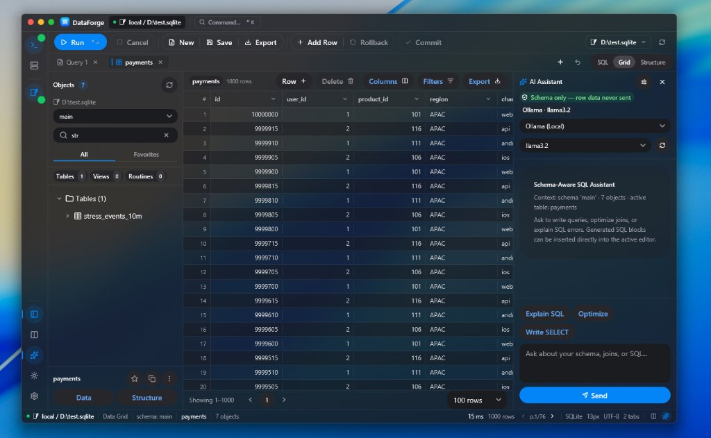

<div align="center">


# DataForge

**Un atelier SQL et bases de données natif, rapide et économe en mémoire, écrit en Rust pour Windows.**

[](https://github.com/williamcachamwri/DataForge/actions/workflows/ci.yml)
[](https://github.com/williamcachamwri/DataForge/actions/workflows/release.yml)
[](https://www.rust-lang.org/)
[](#pourquoi-dataforge-existe)
[](#moteurs-pris-en-charge-et-sécurité-des-connexions)
[](#performances-réelles)
[](#performances-réelles)
[](#installation-et-mises-à-jour-automatiques)
[](LICENSE-MIT)

[English](README.md) · [Tiếng Việt](README.vi.md) · [简体中文](README.zh-CN.md) · [日本語](README.ja.md) · [Español](README.es.md) · [Français](README.fr.md)

</div>

---

## Pourquoi DataForge existe

La plupart des clients de bases de données sur poste de travail imposent un compromis frustrant : soit une application Electron qui consomme près d'un gigaoctet de RAM à ne rien faire sur un onglet vide, soit un outil JVM qui met cinq secondes à démarrer avant d'ouvrir un simple fichier SQLite local.

DataForge suit une autre voie. Inspiré par [TablePro](https://github.com/TableProApp/TablePro) et adossé à son cœur Rust, DataForge remplace les webviews multiplateformes par une pile Windows native rendue directement sur **Direct3D 11** via **HeroGPUI**, avec prise en charge des matériaux **Windows 11 DWM** (**Flou gaussien / Gaussian Blur**, **Mica**, **Mica Alt** et **Opaque**).

Le résultat est immédiat : le démarrage à froid avoisine **10 ms**, l'empreinte mémoire reste autour de **~55 Mo** même lors de requêtes et du défilement sur des tables SQLite de **10 millions de lignes**, tout en offrant l'ergonomie attendue au quotidien : autocomplétion sensible au schéma, mode Vim optionnel, édition en ligne par lots, protections Safe Mode, serveur MCP local intégré et assistant SQL IA respectueux de la confidentialité.

---

## Visite guidée

### Éditeur SQL haute vitesse, mode Vim & résultats en direct (`15 ms` sur 10M lignes)
*Flou gaussien Windows 11 sur toute la fenêtre, coloration syntaxique adaptée au dialecte, autocomplétion contextuelle du schéma, édition modale Vim optionnelle (`NORMAL` / `INSERT` / `VISUAL` / `COMMAND`) et panneau de résultats partagé en direct.*


---

### Grille de données virtualisée, clés étrangères & filtrage paramétré
*Rendu virtualisé à 60+ FPS avec édition de cellules en ligne, validation ou annulation groupée (`Commit` / `Rollback`), colonnes d'en-tête figées, gestion de la visibilité des colonnes, filtres paramétrés multi-opérateurs, inspecteur structure/DDL/clés étrangères et export atomique.*


---

### Assistant IA limité au schéma (Confidentialité d'abord)
*Tiroir latéral droit non bloquant de `320px` connecté à Ollama en local (ex. `llama3.2`) ou à des fournisseurs cloud avec votre propre clé (BYOK). Seules les métadonnées du schéma quittent votre machine : les lignes de vos tables restent strictement locales.*



---

## Présentation détaillée des fonctionnalités

### Moteurs pris en charge et sécurité des connexions

DataForge compile **9 pilotes natifs de bases de données** directement dans son exécutable—sans pilotes ODBC externes ni plugins à installer :

| Moteur | Crate du pilote | Points forts |
| :--- | :--- | :--- |
| **PostgreSQL** | `tablepro-driver-postgres` | `tokio-postgres` + `deadpool`, prise en charge `COPY IN`, inspection schéma/DDL |
| **MySQL / MariaDB** | `tablepro-driver-mysql` | Support complet du dialecte SQL et des métadonnées de catalogue |
| **SQLite** | `tablepro-driver-sqlite` | Ouverture directe de fichiers `.sqlite` / `.db` sans configuration |
| **DuckDB** | `tablepro-driver-duckdb` | DuckDB 2.0 embarqué avec support intégré `json` et `parquet` |
| **Microsoft SQL Server** | `tablepro-driver-mssql` | TDS 8.0 en Rust pur (`tiberius`), TLS adapté à Windows et lots multi-résultats |
| **ClickHouse** | `tablepro-driver-clickhouse` | Requêtes analytiques natives HTTP/TLS via `hyper-rustls` |
| **Cassandra / ScyllaDB** | `tablepro-driver-cassandra` | Pilote CQL natif (`scylla`) avec transport `rustls` |
| **MongoDB** | `tablepro-driver-mongodb` | Requêtes documentaires, mappage BSON 3 et résolution DNS seed list |
| **Redis** | `tablepro-driver-redis` | Inspection clé-valeur et exécution de commandes sur TLS/TCP asynchrone |

La sécurité est intégrée dès la couche de connexion :

- **Tunneling SSH intégré** : Client SSH `russh` embarqué (`tablepro-ssh`) avec authentification par mot de passe ou clé privée, invite de phrase secrète interactive et vérification de clé d'hôte—aucun binaire `ssh.exe` externe requis.
- **TLS et magasin de certificats Windows** : Basé sur `rustls` (`aws-lc-rs`) et `rustls-platform-verifier`, prenant en charge les modes `Disable`, `Prefer`, `Require`, `VerifyCA` et `VerifyFull`, avec CA, certificat client et clé client personnalisés.
- **Gestionnaire d'informations d'identification Windows** : Les mots de passe de bases, secrets SSH, clés API IA et jetons MCP sont stockés dans le **Gestionnaire d'informations d'identification Windows** (`CredWriteW` / `CredReadW` avec effacement mémoire `zeroize`)—jamais en clair dans les fichiers de configuration ou journaux.
- **Gardes Safe Mode** : Configurez vos connexions en mode `Off`, `ConfirmWrites` ou `ReadOnly` pour exiger une confirmation explicite ou bloquer tout `UPDATE`, `DELETE` ou `DROP`.
- **Importation de connexions tierces** : Importez vos connexions et requêtes enregistrées depuis d'autres clients via `tablepro-foreign-import`.

---

### Éditeur SQL et grille haute volumétrie

- **Éditeur SQL sensible au dialecte** :
  - Coloration syntaxique en temps réel par dialecte (`PostgreSQL`, `MySQL`, `SQLite`, `MsSql`, etc.) avec palettes indépendantes pour l'interface et le code.
  - Autocomplétion contextuelle des tables, colonnes, schémas, mots-clés SQL et extraits (`FROM`, `JOIN`, `INTO`, `UPDATE`, etc.).
  - Édition multi-curseur, **mode Vim** optionnel (`Normal`, `Insert`, `Visual`, `Command`), bibliothèque de requêtes enregistrées et historique persistant.
  - Exécutez tout le tampon (`Ctrl+Enter` / `F5`), uniquement la sélection (`Ctrl+Shift+Enter`), ou annulez une requête en cours (`Shift+Esc`).
- **Grille de données virtualisée interactive** :
  - Défilement fluide sur de grands jeux de données avec **Row Inspector** ancré (`Ctrl+I`) et onglets **Structure / Colonnes / Index / Clés étrangères / DDL**.
  - **Édition de cellules en ligne** : Modifiez des valeurs, insérez des lignes (`Alt+Insert`) ou marquez des lignes à supprimer (`Ctrl+Shift+Backspace`) dans un lot en attente—vérifiez vos changements avant de cliquer sur **Commit** (`Ctrl+Shift+S`) ou **Rollback** (`Ctrl+Shift+R`).
  - **Colonnes d'en-tête figées** : Épinglez les premières colonnes (jusqu'à 2/3 de la largeur visible), affichez/masquez des colonnes et redimensionnez à la souris.
  - **Filtrage paramétré par colonne** : Combinez des règles via 11 opérateurs sûrs adaptés au dialecte (`=`, `!=`, `Contains`, `StartsWith`, `EndsWith`, `<`, `<=`, `>`, `>=`, `IS NULL`, `IS NOT NULL`).
  - **Exports atomiques** : Exportez vos résultats ou tables en **CSV** (`.csv`), **JSON Array** (`.json`), **JSON Lines** (`.jsonl`) ou **SQL `INSERT`** (`.sql`) depuis la fenêtre d'export (`Ctrl+Shift+E`), écrits de façon atomique via des fichiers temporaires `.part` (`tablepro-core` fournit également des encodeurs TSV, XML et XLSX).

---

### Apparence, arrière-plans Windows DWM & localisation

- **14 thèmes intégrés + import VS Code** :
  - Livré avec **14 préréglages** : `Dark`, `Light`, `High Contrast`, `Gaussian Glass Dark`, `Gaussian Glass Light`, `Tokyo Night`, `Dracula`, `Catppuccin Mocha`, `One Dark Pro`, `Nord`, `Monokai Pro`, `Gruvbox Dark`, `GitHub Light` et `Catppuccin Latte`.
  - Associez librement votre **Thème d'interface** et votre **Palette de syntaxe SQL**, ou importez tout **thème `.json` VS Code** (avec contrôle de taille, profondeur et traversée de chemin).
- **Matériaux natifs Windows 11 DWM** : Basculez entre **Gaussian Blur**, **Mica**, **Mica Alt** et **Opaque**, tout en gardant les fenêtres flottantes opaques (`1.0` alpha) pour une lisibilité irréprochable.
- **Accessibilité animations réduites** : Détecte automatiquement `SPI_GETCLIENTAREAANIMATION` sous Windows afin d'afficher tiroirs et modales en `0 ms` lorsque les animations système sont désactivées.
- **6 langues d'interface et de diagnostics** :
  - `en-US` (English) · `vi-VN` (Tiếng Việt) · `zh-CN` (简体中文) · `ja-JP` (日本語) · `es-ES` (Español) · `fr-FR` (Français)

---

### Assistant IA local-first & serveur MCP intégré

- **Tiroir IA respectueux de la vie privée (`Ctrl+Shift+A`)** :
  - **Garantie schéma uniquement** : Seul le contexte de schéma (noms de tables, colonnes, types et langage de requête) est transmis au modèle. Aucune donnée de ligne n'est envoyée.
  - **Fournisseurs locaux & BYOK** : Compatible immédiatement avec **Ollama** en local (`http://127.0.0.1:11434/v1`, ex. `llama3.2`) et tout point de terminaison **compatible OpenAI**, ainsi qu'**OpenAI** et **Anthropic** (clés API protégées dans Windows Credential Manager).
  - Réponses en streaming temps réel avec blocs SQL colorés prêts à copier.
- **Serveur MCP local intégré (`tablepro-mcp`)** :
  - Expose vos connexions actives à vos IDE ou agents de code via un serveur HTTP local (`127.0.0.1`), sécurisé par un jeton Bearer stocké dans Windows Credential Manager.
  - Propose **11 outils MCP structurés** : `list_connections`, `connect`, `list_databases`, `list_schemas`, `list_tables`, `describe_table`, `get_table_ddl`, `browse_table`, `count_rows`, `execute_query` et `export_data`.
  - `execute_query` respecte les règles External Clients / Safe Mode et demande une approbation explicite dans DataForge avant toute écriture.

---

### CLI & automatisation sans interface

`dataforge.exe` sert à la fois de lanceur graphique et d'outil CLI scriptable (`tablepro-cli`) :

- **Options applicatives** :
  - `dataforge.exe --version` (`-V`) — Affiche la version et quitte.
  - `dataforge.exe --help` (`-h`) — Affiche l'aide et les options.
  - `dataforge.exe --smoke-startup` — Mesure le démarrage à froid sans interface et vérifie l'enregistrement des `9/9` pilotes.
- **Ouverture directe & instance unique** :
  - Passez des fichiers `.sqlite` / `.db` / `.duckdb` / `.sql` ou des URL de connexion (`postgresql://...`) directement à `dataforge.exe` pour les ouvrir dans la fenêtre active via Named Pipe IPC (ou ajoutez `-n` / `--new-window`).
- **Sous-commandes CLI** :
  - `open`, `query`, `connections`, `databases`, `schemas`, `tables`, `describe`, `export`, `status` et `completion` (`bash`, `zsh`, `fish`).
  - Prend en charge `--format` (`table`, `csv`, `tsv`, `json`, `jsonl` pour `query` ; `csv`, `json`, `sql` pour `export`), `--read-only`, `--limit` et `--timeout`.

```powershell
# Exécuter une requête en lecture seule depuis PowerShell au format JSON Lines
.\target\release\dataforge.exe query -c Staging --read-only --format jsonl "SELECT id, email FROM users LIMIT 10"

# Afficher le DDL CREATE TABLE d'une table
.\target\release\dataforge.exe describe -c Staging --ddl users
```

---

## Performances réelles

Mesuré sous Windows 11 avec une compilation Release de `dataforge.exe` (`--release`) :

| Benchmark | Résultat observé |
| :--- | :--- |
| **Démarrage à froid (`--smoke-startup`, 9/9 pilotes)** | `9.21 – 10.11 ms` |
| **Insertion E2E 100k lignes SQLite (`sqlite_100k_rows_load_and_scroll_perf`)** | `78.97 ms` |
| **Chargement grille 100k lignes + défilement 10k images** | `24.43 ms` chargement · `0.432 ms` scroll (`0.043 µs/image`) |
| **Requête indexée sur 10M de lignes (`ORDER BY event_ts DESC LIMIT 1000`)** | `5 – 15 ms` |
| **Scan complet 10M de lignes + JSON + 3 JOINs + 3 Window Functions** | `40.01 s` |
| **Mémoire RAM pendant les tests de charge 100k / 500k / 1M lignes** | `~55 Mo` constants |

---

## Installation et mises à jour automatiques

Téléchargez les binaires Windows x64 depuis [**GitHub Releases**](https://github.com/williamcachamwri/DataForge/releases) :

- **Installateur (Recommandé) — `DataForge-win-Setup.exe`** :
  - S'installe proprement dans `%LocalAppData%` avec raccourcis Menu Démarrer et Bureau—**sans élévation administrateur UAC requise**.
  - Propulsé par **Velopack** pour des mises à jour delta silencieuses et légères. DataForge vérifie les mises à jour au démarrage (configurable dans **Settings → About**) et permet de vérifier, télécharger et redémarrer pour appliquer une mise à jour depuis **Settings → About**.
- **Archive portable — `DataForge-win-Portable.zip`** :
  - Décompressez n'importe où et lancez directement `dataforge.exe` en mode autonome sans modifier l'état d'installation système.
- **Vérification d'intégrité** :
  - Chaque version publie un fichier `SHA256SUMS.txt` vérifiable sous PowerShell :

```powershell
Get-FileHash .\DataForge-win-Setup.exe -Algorithm SHA256
```

---

## Raccourcis clavier essentiels

| Raccourci | Action |
| :--- | :--- |
| `Ctrl+K` / `Ctrl+Shift+K` / `Ctrl+P` | Ouvrir la palette de commandes |
| `Ctrl+Enter` / `F5` | Exécuter la requête SQL active |
| `Ctrl+Shift+Enter` | Exécuter la sélection SQL |
| `Shift+Esc` | Annuler la requête en cours |
| `Ctrl+S` | Enregistrer la requête dans la bibliothèque |
| `Ctrl+T` / `Ctrl+W` / `Ctrl+Shift+T` | Nouvel onglet / Fermer l'onglet / Rouvrir l'onglet fermé |
| `Ctrl+Tab` / `Ctrl+Shift+Tab` | Onglet suivant / précédent |
| `Ctrl+F` | Cibler le filtre du panneau latéral |
| `Ctrl+B` | Afficher/masquer la barre latérale des objets |
| `Ctrl+I` | Afficher/masquer le Row Inspector |
| `Ctrl+Shift+A` | Afficher/masquer le tiroir Assistant IA |
| `Ctrl+Shift+O` | Ouvrir la bibliothèque de connexions |
| `Ctrl+,` | Ouvrir les Paramètres |
| `Ctrl+Shift+M` | Basculer / changer de thème |
| `Ctrl+Shift+S` / `Ctrl+Shift+R` | Valider (`Commit`) / Annuler (`Rollback`) les éditions de la grille |
| `Alt+Insert` / `Ctrl+Shift+Backspace` | Ajouter une ligne / Supprimer les lignes sélectionnées |
| `Ctrl+Shift+E` | Exporter les résultats ou la table |
| `Esc` | Fermer la modale ou superposition active |

*Astuce : Activez le **mode Vim** dans la barre d'outils de l'éditeur SQL pour naviguer en modes `NORMAL`, `INSERT`, `VISUAL` et commandes `:`.*

---

## Compiler depuis les sources sous Windows

### Prérequis

- **Système d'exploitation** : Windows 10 ou Windows 11 (x64)
- **Chaîne d'outils Rust** : Toolchain stable MSVC (`x86_64-pc-windows-msvc`, Rust `2024` Edition) via [rustup](https://rustup.rs/)
- **Visual Studio C++ Build Tools & Windows SDK** : Requis pour Win32, Direct3D 11 (`HeroGPUI`) et les pilotes C embarqués
- **Shell** : Windows PowerShell (utilisez `;` au lieu de `&&` pour enchaîner les commandes)

> [!CAUTION]
> **Compilez et testez toujours avec `--release`** : N'exécutez jamais `cargo build` ou `cargo test` en mode debug non profilé sur l'ensemble du workspace, sauf besoin explicite de symboles de débogage. Les fichiers PDB de débogage de tout le workspace et des 9 pilotes dans `target\debug` peuvent dépasser **140 Go**. Utilisez toujours `--release` (et `-j 1` sur les machines contraintes en mémoire).

### Vérifier, compiler et lancer

```powershell
# Vérifier qu'aucun processus dataforge.exe ne verrouille le binaire cible
Get-Process dataforge -ErrorAction SilentlyContinue

# Vérification de compilation en mode release
cargo check --release -j 1 -p dataforge-windows-app

# Compiler le binaire release
cargo build --release -j 1 -p dataforge-windows-app

# Vérifier le démarrage à froid et l'enregistrement des 9/9 pilotes
.\target\release\dataforge.exe --smoke-startup

# Lancer DataForge
.\target\release\dataforge.exe
```

### Exécuter les suites de tests Release

```powershell
# Tests unitaires des filtres et dialectes SQL
cargo test --release -j 1 -p tablepro-core filter

# Tests de performance au démarrage et couverture des 6 langues
cargo test --release -j 1 -p dataforge-e2e --test startup_perf_e2e -- --nocapture

# Benchmark E2E chargement 100k lignes SQLite & scroll 10k images
cargo test --release -j 1 -p dataforge-e2e --test sqlite_e2e -- --nocapture
```

---

## Architecture et plan du workspace

```text
DataForge/
├── core/                             # Cœur TablePro amont & 9 pilotes natifs
│   └── crates/
│       ├── core/                     # tablepro-core : modèles de requête, filtres, dialectes, exports
│       ├── session/                  # tablepro-session : sessions actives, pools, transactions
│       ├── cli/                      # tablepro-cli : sous-commandes shell & exécution sans UI
│       ├── mcp/                      # tablepro-mcp : serveur MCP HTTP local protégé par jeton
│       ├── ai/                       # tablepro-ai : client schéma-seul Ollama / OpenAI / Anthropic
│       ├── ssh/                      # tablepro-ssh : tunnel SSH intégré via russh
│       ├── net/                      # tablepro-net : rustls TLS + magasin de certificats système
│       ├── storage/                  # tablepro-storage : connexions, bibliothèque & historique
│       ├── foreign-import/           # tablepro-foreign-import : import depuis d'autres clients
│       ├── account/                  # tablepro-account : traits de compte & jetons
│       └── drivers/                  # postgres, mysql, sqlite, duckdb, mssql, clickhouse,
│                                     # cassandra, mongodb, redis
└── crates/
    ├── dataforge-gfx/                # Glyphes vectoriels & icônes des moteurs
    ├── dataforge-state/              # État éditeur, autocomplétion, grille, onglets, 14 thèmes
    ├── dataforge-services/           # Runtime Tokio asynchrone, orchestration session/IA/MCP, diagnostics
    ├── dataforge-windows-platform/   # Paramètres JSON, Windows Credential Manager, DWM & animations réduites
    ├── dataforge-windows-app/        # App HeroGPUI (Direct3D 11), mise à jour Velopack, 6 langues
    └── dataforge-e2e/                # Benchmarks E2E SQLite, DuckDB, démarrage & grille
```

---

## Contribution, Sécurité, Code de Conduite & Licence

- **Contribuer** : Consultez [CONTRIBUTING.md](CONTRIBUTING.md) pour les notes d'architecture, les règles de compilation `--release`, les contraintes de superposition HeroGPUI et les conventions de localisation en 6 langues.
- **Journal des modifications** : Consultez [CHANGELOG.md](CHANGELOG.md).
- **Code de conduite** : Consultez [CODE_OF_CONDUCT.md](CODE_OF_CONDUCT.md).
- **Politique de sécurité** : Consultez [SECURITY.md](SECURITY.md) pour le signalement privé des vulnérabilités et nos garanties de confidentialité locale.
- **Licence** : DataForge est distribué sous [LICENSE](LICENSE) (GNU Affero General Public License v3.0) et [LICENSE-MIT](LICENSE-MIT), avec attribution au cœur [TableProApp/TablePro](https://github.com/TableProApp/TablePro) (MIT).
