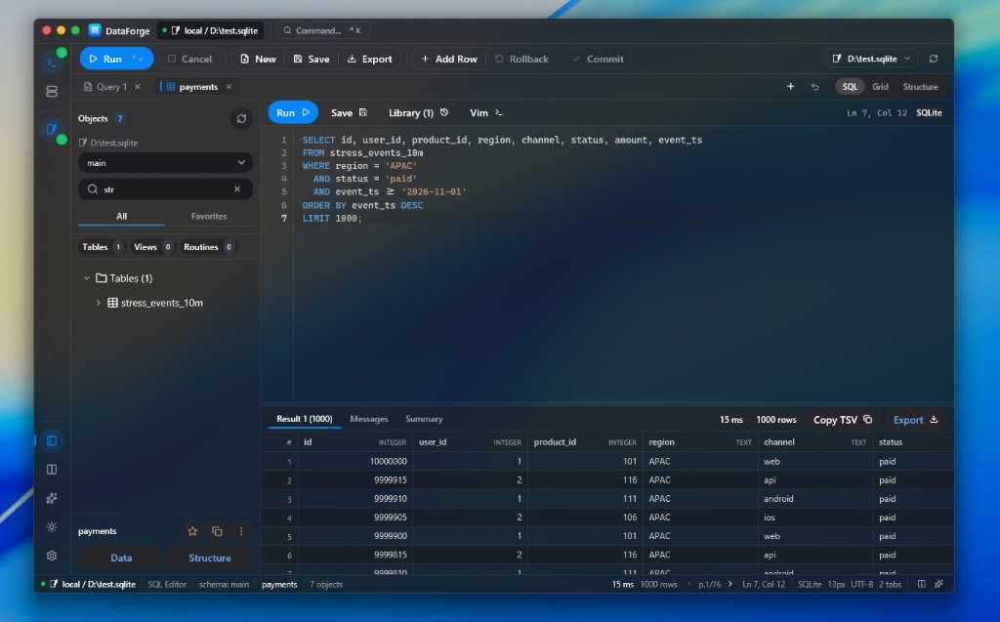

<div align="center">


# DataForge

**Rust と Direct3D 11 で構築された超高速・省メモリな Windows ネイティブ SQL ワークベンチ。**

[](https://www.rust-lang.org/)
[](#dataforge-の特徴)
[](#対応データベース)
[](#実測ベンチマーク)
[](#実測ベンチマーク)
[](LICENSE-MIT)

[English](README.md) · [Tiếng Việt](README.vi.md) · [简体中文](README.zh-CN.md) · [日本語](README.ja.md) · [Español](README.es.md) · [Français](README.fr.md)

</div>

---

## DataForge の特徴

従来のデータベースクライアントは、Electron 製で 1 GB 近くのメモリを消費したり、JVM ベースで起動に数秒かかったりすることが珍しくありません。

DataForge はドライバ層から GPU レンダリング UI（**HeroGPUI / Direct3D 11** + **Windows 11 ガウスぼかし / Mica**）まですべて **Rust** でネイティブ実装されています。コールドスタートは約 **10 ms**、1,000 万行の SQLite テーブルをクエリしてもメモリ使用量は **~55 MB** に抑えられます。

---

## スクリーンショット

### SQL エディタ & 1,000 万行クエリ (`15 ms`)


### 高密度データグリッド & フィルタリング


### スキーマ認識 AI アシスタント（ローカル優先・プライバシー保護）


---

## 対応データベース

| エンジン | ドライバ Crate |
| :--- | :--- |
| **PostgreSQL** | `tablepro-driver-postgres` |
| **MySQL / MariaDB** | `tablepro-driver-mysql` |
| **SQLite** | `tablepro-driver-sqlite` |
| **DuckDB** | `tablepro-driver-duckdb` |
| **Microsoft SQL Server** | `tablepro-driver-mssql` |
| **ClickHouse** | `tablepro-driver-clickhouse` |
| **Cassandra / ScyllaDB** | `tablepro-driver-cassandra` |
| **MongoDB** | `tablepro-driver-mongodb` |
| **Redis** | `tablepro-driver-redis` |

---

## 実測ベンチマーク

| 計測項目 | 結果 |
| :--- | :--- |
| **コールドスタート (`--smoke-startup`, 9/9 ドライバ)** | `9.21 – 10.11 ms` |
| **10 万行 SQLite E2E (`sqlite_100k_rows_load_and_scroll_perf`)** | `78.97 ms` 投入 · `24.43 ms` 読込 · `0.432 ms` スクロール |
| **1,000 万行インデックス検索 (`LIMIT 1000`)** | `5 – 15 ms` |
| **1,000 万行フルスキャン + `json_extract` + 3表 JOIN + Window 関数** | `40.01 s` |
| **10 万 / 50 万 / 100 万行負荷時の RAM 使用量** | 安定 `~55 MB` |

---

## ビルド方法

```powershell
cargo build --release -p dataforge-windows-app
.\target\release\dataforge.exe --smoke-startup
.\target\release\dataforge.exe
```

## コミュニティ・セキュリティ・ライセンス

- **行動規範**: [CODE_OF_CONDUCT.md](CODE_OF_CONDUCT.md)
- **セキュリティポリシー**: [SECURITY.md](SECURITY.md)
- **ライセンス**: [MIT License](LICENSE-MIT)（上流コア [TableProApp/TablePro](https://github.com/TableProApp/TablePro) への帰属表記を含む）および [LICENSE](LICENSE)。
