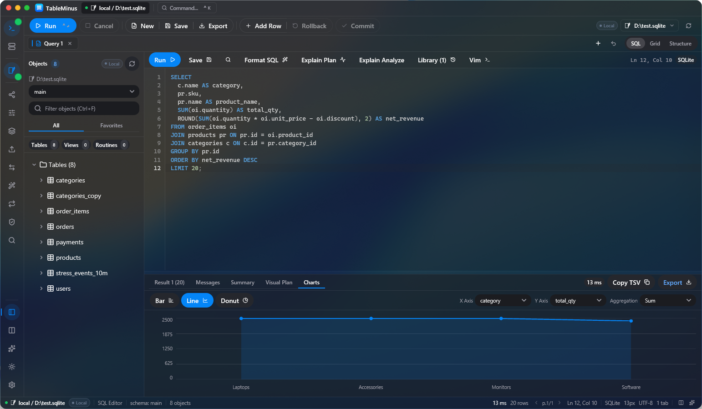
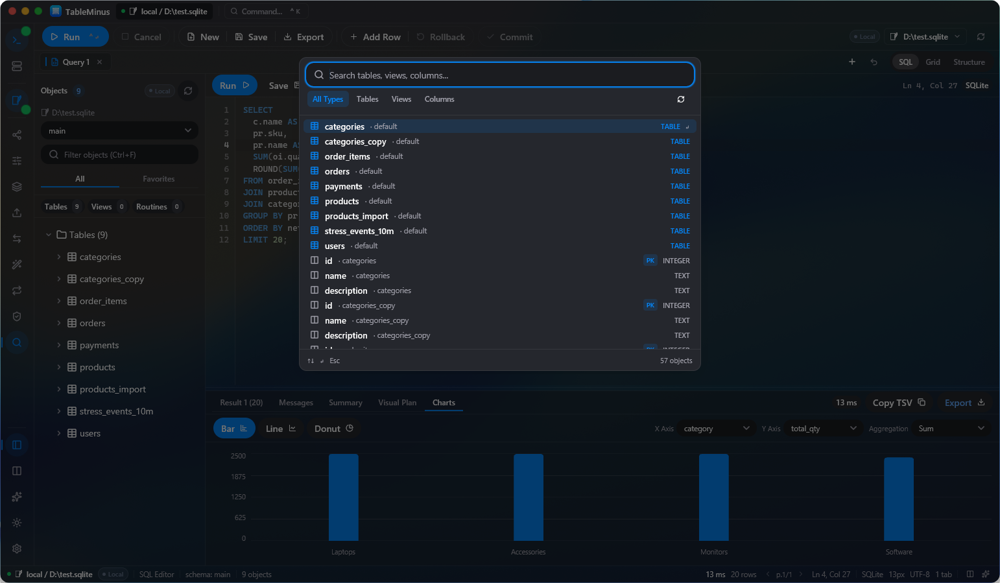

<div align="center">


# TableMinus

**A fast, native SQL & database workbench built in Rust for Windows.**

[](https://github.com/williamcachamwri/TableMinus/actions/workflows/ci.yml)
[](https://github.com/williamcachamwri/TableMinus/actions/workflows/release.yml)
[](https://www.rust-lang.org/)
[](#why-tableminus-exists)
[](#supported-engines--connection-security)
[](#real-world-benchmarks)
[](#real-world-benchmarks)
[](#installation--auto-updates)
[](LICENSE-MIT)

[English](README.md) · [Tiếng Việt](README.vi.md) · [简体中文](README.zh-CN.md) · [日本語](README.ja.md) · [Español](README.es.md) · [Français](README.fr.md)

</div>

---

## Overview

TableMinus is a native Windows SQL and database workbench written in Rust. It uses [HeroGPUI](https://github.com/williamcachamwri/TableMinus) over Direct3D 11 for rendering and builds on [TablePro](https://github.com/TableProApp/TablePro)'s open-source Rust database core, skipping Electron and JVM runtimes altogether.

On Windows 11 release builds, cold startup runs around `10 ms` (measured `9.21` to `10.11 ms` via `--smoke-startup` with all 9 drivers registered), and process memory stays near `~55 MB` during `100k` / `500k` / `1M`-row stress queries. In the `tableminus-e2e` SQLite suite, loading `100k` rows into the grid takes `24.43 ms` and scrolling `10k` frames takes `0.432 ms`.

---

## Screenshots

### SQL editor, live charts, and query results



### Virtualized data grid, column aggregates, and parameterized filters


### Interactive ER Diagram, foreign key relations, and SVG export


### Import Wizard (CSV, JSON, XLSX) with automatic type mapping


### Schema & Data Compare with diff summary and sync script generation


### Mock Data Generator with deterministic seeds and foreign-key ordering


### Cross-Engine Data Transfer with live DDL preview


### Metadata Search palette (`Ctrl+P` / Object Search)



### Schema-only AI drawer (`Ctrl+Shift+A`)


---

## Supported Databases

TableMinus compiles 9 database drivers directly into `tableminus.exe`, with no external ODBC setup or runtime plugins required:

| Database | Driver Crate | Notes |
| :--- | :--- | :--- |
| PostgreSQL | `tablepro-driver-postgres` | `tokio-postgres` + `deadpool`, `COPY IN`, schema and DDL inspection |
| MySQL / MariaDB | `tablepro-driver-mysql` | Full SQL dialect and catalog metadata |
| SQLite | `tablepro-driver-sqlite` | Local `.sqlite` / `.db` files via file open, drag-and-drop, or CLI |
| DuckDB | `tablepro-driver-duckdb` | Bundled DuckDB 2.0 with `json` and `parquet` linked in |
| Microsoft SQL Server | `tablepro-driver-mssql` | Pure-Rust TDS 8.0 (`tiberius`) with TLS and multi-result batches |
| ClickHouse | `tablepro-driver-clickhouse` | HTTP/TLS queries via `hyper-rustls` |
| Cassandra / ScyllaDB | `tablepro-driver-cassandra` | Native CQL (`scylla`) over `rustls` |
| MongoDB | `tablepro-driver-mongodb` | Document queries, BSON 3 mapping, DNS seed list resolution |
| Redis | `tablepro-driver-redis` | Key-value inspection and command execution over async TLS/TCP |

Connections support in-process SSH tunneling via `russh` (`tablepro-ssh` with password, private key, passphrase prompt, and host-key verification), TLS via `rustls` and the Windows certificate store (`Disable`, `Prefer`, `Require`, `VerifyCA`, `VerifyFull`, plus custom CA and client cert/key files), Safe Mode policies (`Off`, `ConfirmWrites`, `ReadOnly`), and importing saved connections from other database tools via `tablepro-foreign-import`.

---

## Features

### SQL Editor & Data Grid

The editor supports dialect-aware syntax highlighting (`PostgreSQL`, `MySQL`, `SQLite`, `MsSql`, and others), autocomplete for tables, columns, schemas, keywords, and SQL clauses (`FROM`, `JOIN`, `INTO`, `UPDATE`), multi-cursor editing, a saved query library, persistent query history, and optional Vim mode (`NORMAL`, `INSERT`, `VISUAL`, `COMMAND`).

In the data grid, you can inspect rows in a docked Row Inspector (`Ctrl+I`), switch between Structure, Columns, Indexes, Foreign Keys, and DDL tabs, pin leading columns up to 2/3 of the viewport width, resize or hide columns, and stack parameterized filters across 11 operators (`=`, `!=`, `Contains`, `StartsWith`, `EndsWith`, `<`, `<=`, `>`, `>=`, `IS NULL`, `IS NOT NULL`). Cell edits, inserted rows (`Alt+Insert`), and deleted rows (`Ctrl+Shift+Backspace`) are staged in a batch until you commit (`Ctrl+Shift+S`) or roll back (`Ctrl+Shift+R`).

Query results and tables export atomically through `.part` staging files to CSV (`.csv`), JSON Array (`.json`), JSON Lines (`.jsonl`), or SQL `INSERT` (`.sql`) via `Ctrl+Shift+E`. `tablepro-core` also includes TSV, XML, and constant-memory XLSX encoders.

### Security & Local Storage

Database passwords, SSH secrets, AI API keys, and MCP bearer tokens are stored in Windows Credential Manager (`CredWriteW` / `CredReadW`) and scrubbed from memory with `zeroize` rather than written to plain JSON config files or logs. Connections can be locked to `ConfirmWrites` or `ReadOnly` in Safe Mode so `UPDATE`, `DELETE`, and `DROP` statements either prompt first or fail before execution.

### AI Assistant & MCP Server

The AI drawer (`Ctrl+Shift+A`) connects to local Ollama (`http://127.0.0.1:11434/v1`), any OpenAI-compatible server, OpenAI, or Anthropic. Only schema metadata (table names, column names, types, and SQL dialect) is sent to the model; table row data stays local.

For external coding agents and IDEs, `tablepro-mcp` runs a loopback HTTP MCP server on `127.0.0.1` authenticated with a Bearer token in Windows Credential Manager and peer verification. It exposes 11 tools:

- `list_connections`, `connect`, `list_databases`, `list_schemas`, `list_tables`, `describe_table`, `get_table_ddl`, `browse_table`, `count_rows`, `execute_query`, and `export_data`

`execute_query` obeys each connection's External Clients and Safe Mode settings and requires confirmation inside TableMinus before any write query runs.

### Themes, Backdrops & Languages

TableMinus includes 14 built-in themes (`Dark`, `Light`, `High Contrast`, `Gaussian Glass Dark`, `Gaussian Glass Light`, `Tokyo Night`, `Dracula`, `Catppuccin Mocha`, `One Dark Pro`, `Nord`, `Monokai Pro`, `Gruvbox Dark`, `GitHub Light`, and `Catppuccin Latte`). UI themes and syntax palettes can be chosen independently, or you can import a VS Code `.json` color theme.

On Windows 11, the main window supports DWM `Gaussian Blur`, `Mica`, `Mica Alt`, and `Opaque` materials while keeping floating overlays opaque (`1.0` alpha) for readability. Reduced Motion follows Windows `SPI_GETCLIENTAREAANIMATION` so drawers and modals skip transitions when system animations are turned off. All UI labels, menus, modals, tooltips, and driver diagnostics are localized in 6 languages: `en-US`, `vi-VN`, `zh-CN`, `ja-JP`, `es-ES`, and `fr-FR`.

### CLI Usage

`tableminus.exe` works as both the desktop launcher and a scriptable CLI (`tablepro-cli`). Passing `.sqlite`, `.db`, `.duckdb`, or `.sql` file paths or connection URLs (`postgresql://...`) opens them in the running instance over Named Pipe IPC (pass `-n` / `--new-window` to open a separate window).

Top-level flags:
- `--version` (`-V`) prints the version and exits.
- `--help` (`-h`) prints CLI usage and options.
- `--smoke-startup` runs a headless startup timing check and verifies all 9 drivers register.

Subcommands: `open`, `query`, `connections`, `databases`, `schemas`, `tables`, `describe`, `export`, `status`, and `completion` (`bash`, `zsh`, `fish`), with `--format`, `--read-only`, `--limit`, and `--timeout` options.

```powershell
# Run a read-only query and print JSON Lines
.\target\release\tableminus.exe query -c Staging --read-only --format jsonl "SELECT id, email FROM users LIMIT 10"

# Print CREATE TABLE DDL for a table
.\target\release\tableminus.exe describe -c Staging --ddl users
```

---

## Download & Install

Requires **Windows 10 or Windows 11 (x64)**. Prebuilt binaries are published on [GitHub Releases](https://github.com/williamcachamwri/TableMinus/releases):

- **Installer (`TableMinus-win-Setup.exe`)**: Installs into `%LocalAppData%` with Start Menu and desktop shortcuts without requiring UAC elevation. Uses Velopack for background binary delta updates, configurable in **Settings -> About**.
- **Portable (`TableMinus-win-Portable.zip`)**: Extract to any folder and run `tableminus.exe` directly without modifying installer state.

Each release includes `SHA256SUMS.txt` so you can check downloads in PowerShell:

```powershell
Get-FileHash .\TableMinus-win-Setup.exe -Algorithm SHA256
```

---

## Keyboard Shortcuts

| Shortcut | Action |
| :--- | :--- |
| `Ctrl+K` / `Ctrl+Shift+K` / `Ctrl+P` | Open Command Palette |
| `Ctrl+Enter` / `F5` | Run active SQL query |
| `Ctrl+Shift+Enter` | Run selected SQL text |
| `Shift+Esc` | Cancel running query |
| `Ctrl+S` | Save query to library |
| `Ctrl+T` / `Ctrl+W` / `Ctrl+Shift+T` | New query tab / Close tab / Reopen closed tab |
| `Ctrl+Tab` / `Ctrl+Shift+Tab` | Next / Previous tab |
| `Ctrl+F` | Focus object sidebar filter |
| `Ctrl+B` | Toggle object sidebar |
| `Ctrl+I` | Toggle Row Inspector |
| `Ctrl+Shift+A` | Toggle AI Assistant drawer |
| `Ctrl+Shift+O` | Open Connections library |
| `Ctrl+,` | Open Settings |
| `Ctrl+Shift+M` | Cycle theme |
| `Ctrl+Shift+S` / `Ctrl+Shift+R` | Commit / Rollback staged grid edits |
| `Alt+Insert` / `Ctrl+Shift+Backspace` | Add row / Delete selected rows in grid |
| `Ctrl+Shift+E` | Export results or table |
| `Esc` | Dismiss active modal or overlay |

Vim navigation (`NORMAL`, `INSERT`, `VISUAL`, and `:` commands) can be enabled from the SQL editor toolbar.

---

## Build from Source

### Prerequisites

- Windows 10 or Windows 11 (x64)
- Stable Rust MSVC toolchain (`x86_64-pc-windows-msvc`, Rust `2024` Edition) via [rustup](https://rustup.rs/)
- Visual Studio C++ Build Tools and Windows SDK (for Win32, Direct3D 11, and bundled C drivers)
- Windows PowerShell (use `;` instead of `&&` to chain commands)

> [!CAUTION]
> Always build and test with `--release`. Avoid running unprofiled debug `cargo build` or `cargo test` across the workspace unless you specifically need debug symbols, as PDB files in `target\debug` for all crates and 9 drivers grow past 140 GB. Pass `-j 1` on memory-constrained machines.

### Build & Test Commands

```powershell
# Make sure an existing tableminus.exe process is not locking target\release\tableminus.exe
Get-Process tableminus -ErrorAction SilentlyContinue

# Type-check and build the release binary
cargo check --release -j 1 -p tableminus-windows-app
cargo build --release -j 1 -p tableminus-windows-app

# Run the headless startup check and launch the app
.\target\release\tableminus.exe --smoke-startup
.\target\release\tableminus.exe
```

Release test suites:

```powershell
cargo test --release -j 1 -p tablepro-core filter
cargo test --release -j 1 -p tableminus-e2e --test startup_perf_e2e -- --nocapture
cargo test --release -j 1 -p tableminus-e2e --test sqlite_e2e -- --nocapture
```

### Workspace Layout

| Path | Role |
| :--- | :--- |
| `core/crates/core` | `tablepro-core`: query models, filters, SQL dialects, export encoders |
| `core/crates/session` | `tablepro-session`: live sessions, connection pools, transactions |
| `core/crates/cli` | `tablepro-cli`: CLI subcommands and headless runner |
| `core/crates/mcp` | `tablepro-mcp`: token-authenticated localhost MCP HTTP server |
| `core/crates/ai` | `tablepro-ai`: schema-only Ollama, OpenAI, and Anthropic client |
| `core/crates/ssh` | `tablepro-ssh`: in-process `russh` SSH tunneling |
| `core/crates/net` | `tablepro-net`: `rustls` TLS and system certificate verification |
| `core/crates/storage` | `tablepro-storage`: saved connections, query library, history |
| `core/crates/foreign-import` | `tablepro-foreign-import`: import connections from other DB clients |
| `core/crates/account` | `tablepro-account`: account and token traits |
| `core/crates/drivers/*` | 9 database drivers (`postgres`, `mysql`, `sqlite`, `duckdb`, `mssql`, `clickhouse`, `cassandra`, `mongodb`, `redis`) |
| `crates/tableminus-gfx` | Vector glyphs and database engine icons |
| `crates/tableminus-state` | Editor state, autocomplete, grid model, tabs, 14 built-in themes |
| `crates/tableminus-services` | Async Tokio runtime, session/AI/MCP orchestration, localized diagnostics |
| `crates/tableminus-windows-platform` | Settings JSON, Win32 Credential Manager, DWM and Reduced Motion helpers |
| `crates/tableminus-windows-app` | HeroGPUI (Direct3D 11) desktop app, Velopack updater, 6 locales |
| `crates/tableminus-e2e` | SQLite, DuckDB, startup, and grid performance benchmarks |

---

## Contributing & License

Contributions, bug reports, and translation fixes are welcome. See [CONTRIBUTING.md](CONTRIBUTING.md) for build and GPUI rules, [CHANGELOG.md](CHANGELOG.md) for release notes, [CODE_OF_CONDUCT.md](CODE_OF_CONDUCT.md), and [SECURITY.md](SECURITY.md) for private vulnerability reporting.

### License Boundary (`AGPL-3.0-or-later` vs `MIT`)

| Scope | License | Notes |
| :--- | :--- | :--- |
| `crates/*`, `web/`, and compiled `tableminus.exe` binaries | **[AGPL-3.0-or-later](LICENSE)** | TableMinus Windows desktop shell, UI, state, services, and website. Linking `core/` into `tableminus.exe` distributes the combined work under AGPL-3.0. |
| `core/` (`core/crates/*`) | **[MIT](LICENSE-MIT)** *(upstream)* | Upstream TablePro core crates ([TableProApp/TablePro](https://github.com/TableProApp/TablePro)). Independent reuse of unmodified upstream `core/` components retains MIT terms under [LICENSE-MIT](LICENSE-MIT). |
