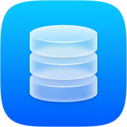
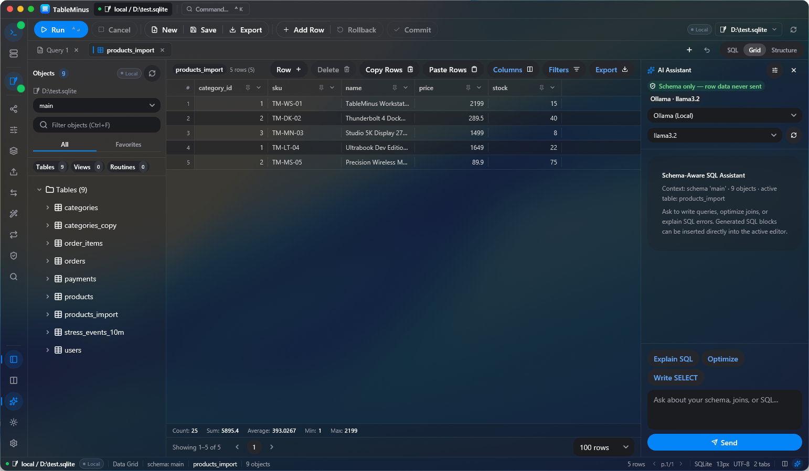

<div align="center">



# TableMinus

**Trình quản lý cơ sở dữ liệu và SQL workbench thuần Rust cho Windows.**

[](https://github.com/williamcachamwri/TableMinus/actions/workflows/ci.yml)
[](https://github.com/williamcachamwri/TableMinus/actions/workflows/release.yml)
[](https://www.rust-lang.org/)
[](#tổng-quan)
[](#hệ-quản-trị-csdl-được-hỗ-trợ)
[](#tổng-quan)
[](#tổng-quan)
[](#tải-về-và-cài-đặt)
[](LICENSE-MIT)

[English](README.md) · [Tiếng Việt](README.vi.md) · [简体中文](README.zh-CN.md) · [日本語](README.ja.md) · [Español](README.es.md) · [Français](README.fr.md)

</div>

---

## Tổng quan

TableMinus là ứng dụng SQL và quản lý cơ sở dữ liệu viết bằng Rust dành riêng cho Windows. Giao diện dựng bằng [HeroGPUI](https://github.com/williamcachamwri/TableMinus) trên nền Direct3D 11 và sử dụng lõi Rust mã nguồn mở của [TablePro](https://github.com/TableProApp/TablePro), không chạy qua Electron hay JVM.

Trên bản dựng release ở Windows 11, thời gian khởi động lạnh đo được quanh mức `10 ms` (từ `9.21` đến `10.11 ms` qua `--smoke-startup` khi nạp đủ 9 driver), còn bộ nhớ tiến trình giữ ở khoảng `~55 MB` trong các bài kiểm tra tải `100k`, `500k` và `1M` dòng. Trong bộ test SQLite của `tableminus-e2e`, việc nạp `100k` dòng vào bảng lưới mất `24.43 ms` và cuộn `10k` khung hình mất `0.432 ms`.

---

## Ảnh chụp màn hình

### Trình soạn thảo SQL, biểu đồ trực tiếp và kết quả truy vấn


### Lưới dữ liệu ảo hóa, tổng hợp cột và bộ lọc tham số hóa


### Sơ đồ ER tương tác, quan hệ khóa ngoại và xuất SVG


### Trình hướng dẫn nhập dữ liệu (CSV, JSON, XLSX) tự động ánh xạ kiểu


### So sánh Schema & Dữ liệu kèm tóm tắt khác biệt và tạo script đồng bộ


### Trình tạo dữ liệu giả lập với seed cố định và thứ tự khóa ngoại


### Truyền dữ liệu liên cơ sở dữ liệu kèm xem trước DDL trực tiếp


### Tìm kiếm siêu dữ liệu (`Ctrl+P` / Metadata Search)


### Ngăn trợ lý AI chỉ đọc schema (`Ctrl+Shift+A`)



---

## Hệ quản trị CSDL được hỗ trợ

TableMinus biên dịch sẵn 9 driver vào thẳng tệp `tableminus.exe`, không cần cài thêm ODBC hay plugin ngoài:

| Hệ quản trị | Crate driver | Ghi chú |
| :--- | :--- | :--- |
| PostgreSQL | `tablepro-driver-postgres` | `tokio-postgres` + `deadpool`, hỗ trợ `COPY IN`, xem schema và DDL |
| MySQL / MariaDB | `tablepro-driver-mysql` | Hỗ trợ đầy đủ dialect SQL và metadata danh mục |
| SQLite | `tablepro-driver-sqlite` | Mở trực tiếp tệp `.sqlite` / `.db` qua giao diện, kéo thả hoặc CLI |
| DuckDB | `tablepro-driver-duckdb` | Đóng gói sẵn DuckDB 2.0 kèm `json` và `parquet` |
| Microsoft SQL Server | `tablepro-driver-mssql` | TDS 8.0 thuần Rust (`tiberius`) hỗ trợ TLS và nhiều tập kết quả |
| ClickHouse | `tablepro-driver-clickhouse` | Truy vấn qua HTTP/TLS bằng `hyper-rustls` |
| Cassandra / ScyllaDB | `tablepro-driver-cassandra` | Driver CQL thuần (`scylla`) chạy trên `rustls` |
| MongoDB | `tablepro-driver-mongodb` | Truy vấn document, ánh xạ BSON 3 và phân giải DNS seed list |
| Redis | `tablepro-driver-redis` | Xem key-value và chạy lệnh qua TLS/TCP bất đồng bộ |

Kết nối hỗ trợ SSH tunnel tích hợp sẵn qua `russh` (`tablepro-ssh` với mật khẩu, khóa riêng, hộp thoại nhập passphrase và xác minh host key), TLS qua `rustls` và kho chứng chỉ Windows (`Disable`, `Prefer`, `Require`, `VerifyCA`, `VerifyFull`, hỗ trợ CA riêng và client cert/key), chế độ Safe Mode (`Off`, `ConfirmWrites`, `ReadOnly`), cùng khả năng nhập kết nối đã lưu từ các ứng dụng khác qua `tablepro-foreign-import`.

---

## Tính năng

### Trình soạn thảo SQL và Lưới dữ liệu

Trình soạn thảo hỗ trợ tô màu cú pháp theo từng dialect (`PostgreSQL`, `MySQL`, `SQLite`, `MsSql` và các hệ khác), tự động gợi ý bảng, cột, schema, từ khóa và mệnh đề SQL (`FROM`, `JOIN`, `INTO`, `UPDATE`), chỉnh sửa đa con trỏ, thư viện truy vấn đã lưu, lịch sử truy vấn và tùy chọn chế độ Vim (`NORMAL`, `INSERT`, `VISUAL`, `COMMAND`).

Trong lưới dữ liệu, bạn có thể xem chi tiết bản ghi qua Row Inspector (`Ctrl+I`), chuyển giữa các tab Structure, Columns, Indexes, Foreign Keys và DDL, ghim các cột đầu tối đa 2/3 chiều rộng khung nhìn, ẩn/hiện hoặc kéo giãn cột, và ghép nhiều điều kiện lọc tham số hóa với 11 toán tử (`=`, `!=`, `Contains`, `StartsWith`, `EndsWith`, `<`, `<=`, `>`, `>=`, `IS NULL`, `IS NOT NULL`). Các thao tác sửa ô, thêm dòng (`Alt+Insert`) hay đánh dấu xóa dòng (`Ctrl+Shift+Backspace`) được gom theo lô để kiểm tra trước khi `Commit` (`Ctrl+Shift+S`) hoặc `Rollback` (`Ctrl+Shift+R`).

Kết quả truy vấn và bảng được xuất qua tệp tạm `.part` để đảm bảo ghi nguyên tử sang CSV (`.csv`), JSON Array (`.json`), JSON Lines (`.jsonl`) hoặc câu lệnh SQL `INSERT` (`.sql`) bằng tổ hợp `Ctrl+Shift+E`. Ngoài ra `tablepro-core` còn có bộ mã hóa TSV, XML và XLSX tiết kiệm bộ nhớ.

### Bảo mật và Lưu trữ cục bộ

Mật khẩu cơ sở dữ liệu, khóa SSH, API key AI và Bearer token của MCP được lưu trong Windows Credential Manager (`CredWriteW` / `CredReadW`) và xóa khỏi RAM bằng `zeroize` thay vì ghi dạng văn bản rõ vào tệp cấu hình hay nhật ký. Ở chế độ Safe Mode, kết nối có thể đặt ở mức `ConfirmWrites` hoặc `ReadOnly` để các lệnh `UPDATE`, `DELETE`, `DROP` phải được xác nhận hoặc bị chặn trước khi chạy.

### Trợ lý AI và Máy chủ MCP

Ngăn AI (`Ctrl+Shift+A`) kết nối với Ollama nội bộ (`http://127.0.0.1:11434/v1`), các endpoint tương thích OpenAI, OpenAI hoặc Anthropic. Chỉ thông tin schema (tên bảng, tên cột, kiểu dữ liệu và dialect SQL) được gửi tới mô hình; dữ liệu từng dòng trong bảng luôn nằm lại trên máy.

Với các công cụ lập trình hoặc IDE bên ngoài, `tablepro-mcp` chạy một máy chủ MCP HTTP nội bộ trên `127.0.0.1`, xác thực bằng Bearer token trong Windows Credential Manager và kiểm tra tiến trình gọi. Máy chủ cung cấp 11 công cụ:

- `list_connections`, `connect`, `list_databases`, `list_schemas`, `list_tables`, `describe_table`, `get_table_ddl`, `browse_table`, `count_rows`, `execute_query`, `export_data`

Công cụ `execute_query` tuân thủ cấu hình External Clients và Safe Mode của từng kết nối, đồng thời yêu cầu người dùng bấm xác nhận ngay trong TableMinus trước khi chạy bất kỳ lệnh ghi nào.

### Giao diện, Vật liệu nền và Ngôn ngữ

TableMinus có sẵn 14 bộ giao diện (`Dark`, `Light`, `High Contrast`, `Gaussian Glass Dark`, `Gaussian Glass Light`, `Tokyo Night`, `Dracula`, `Catppuccin Mocha`, `One Dark Pro`, `Nord`, `Monokai Pro`, `Gruvbox Dark`, `GitHub Light`, `Catppuccin Latte`). Bạn có thể chọn tách biệt giao diện khung ứng dụng và bảng màu mã nguồn, hoặc nhập tệp theme `.json` từ VS Code.

Trên Windows 11, cửa sổ chính hỗ trợ các vật liệu nền DWM gồm `Gaussian Blur`, `Mica`, `Mica Alt` và `Opaque`, trong khi các lớp nổi (modal, dropdown, toast) luôn giữ nền đục (`1.0` alpha) để chữ không bị nhòe. Tùy chọn Reduced Motion tự đồng bộ theo `SPI_GETCLIENTAREAANIMATION` của Windows để bỏ qua hiệu ứng chuyển động khi hệ thống tắt hoạt ảnh. Toàn bộ nhãn giao diện, menu, hộp thoại và thông báo lỗi từ driver hỗ trợ 6 ngôn ngữ: `en-US`, `vi-VN`, `zh-CN`, `ja-JP`, `es-ES` và `fr-FR`.

### Sử dụng qua CLI

`tableminus.exe` vừa khởi chạy giao diện đồ họa vừa đóng vai trò công cụ dòng lệnh (`tablepro-cli`). Khi truyền đường dẫn `.sqlite`, `.db`, `.duckdb`, `.sql` hoặc chuỗi kết nối (`postgresql://...`), tệp sẽ mở ngay trong cửa sổ đang chạy qua Named Pipe IPC (thêm `-n` / `--new-window` nếu muốn mở cửa sổ mới).

Các cờ cấp ứng dụng:
- `--version` (`-V`) in phiên bản rồi thoát.
- `--help` (`-h`) in hướng dẫn sử dụng CLI.
- `--smoke-startup` chạy kiểm tra thời gian khởi động không giao diện và xác nhận đủ 9 driver.

Các lệnh con: `open`, `query`, `connections`, `databases`, `schemas`, `tables`, `describe`, `export`, `status` và `completion` (`bash`, `zsh`, `fish`), đi kèm các tùy chọn `--format`, `--read-only`, `--limit` và `--timeout`.

```powershell
# Chạy truy vấn chỉ đọc và xuất kết quả dạng JSON Lines
.\target\release\tableminus.exe query -c Staging --read-only --format jsonl "SELECT id, email FROM users LIMIT 10"

# Xem câu lệnh CREATE TABLE DDL của một bảng
.\target\release\tableminus.exe describe -c Staging --ddl users
```

---

## Tải về và Cài đặt

Yêu cầu **Windows 10 hoặc Windows 11 (x64)**. Các bản dựng sẵn được phát hành tại [GitHub Releases](https://github.com/williamcachamwri/TableMinus/releases):

- **Bộ cài đặt (`TableMinus-win-Setup.exe`)**: Cài vào `%LocalAppData%` kèm lối tắt Start Menu và màn hình nền mà không cần quyền quản trị UAC. Sử dụng Velopack để cập nhật phần sai khác (delta) chạy nền, tùy chỉnh trong **Settings -> About**.
- **Bản Portable (`TableMinus-win-Portable.zip`)**: Giải nén ra thư mục bất kỳ và chạy thẳng `tableminus.exe` mà không ảnh hưởng trạng thái bộ cài.

Mỗi bản phát hành đều kèm tệp `SHA256SUMS.txt` để đối chiếu bằng PowerShell:

```powershell
Get-FileHash .\TableMinus-win-Setup.exe -Algorithm SHA256
```

---

## Phím tắt

| Phím tắt | Thao tác |
| :--- | :--- |
| `Ctrl+K` / `Ctrl+Shift+K` / `Ctrl+P` | Mở Bảng lệnh (Command Palette) |
| `Ctrl+Enter` / `F5` | Chạy truy vấn SQL hiện tại |
| `Ctrl+Shift+Enter` | Chạy đoạn SQL đang bôi đen |
| `Shift+Esc` | Hủy truy vấn đang chạy |
| `Ctrl+S` | Lưu truy vấn vào thư viện |
| `Ctrl+T` / `Ctrl+W` / `Ctrl+Shift+T` | Tab truy vấn mới / Đóng tab / Mở lại tab vừa đóng |
| `Ctrl+Tab` / `Ctrl+Shift+Tab` | Chuyển sang tab kế tiếp / trước đó |
| `Ctrl+F` | Trỏ vào ô lọc thanh đối tượng |
| `Ctrl+B` | Ẩn/hiện thanh bên đối tượng |
| `Ctrl+I` | Ẩn/hiện Row Inspector |
| `Ctrl+Shift+A` | Ẩn/hiện ngăn Trợ lý AI |
| `Ctrl+Shift+O` | Mở thư viện Kết nối |
| `Ctrl+,` | Mở Cài đặt |
| `Ctrl+Shift+M` | Đổi giao diện |
| `Ctrl+Shift+S` / `Ctrl+Shift+R` | Lưu (`Commit`) / Hoàn tác (`Rollback`) thay đổi trên lưới |
| `Alt+Insert` / `Ctrl+Shift+Backspace` | Thêm dòng / Xóa các dòng đang chọn trên lưới |
| `Ctrl+Shift+E` | Xuất kết quả hoặc bảng |
| `Esc` | Đóng hộp thoại hoặc lớp phủ hiện tại |

Chế độ Vim (`NORMAL`, `INSERT`, `VISUAL` và lệnh `:`) có thể bật trực tiếp trên thanh công cụ của trình soạn thảo SQL.

---

## Tự biên dịch từ mã nguồn

### Yêu cầu môi trường

- Windows 10 hoặc Windows 11 (x64)
- Bộ công cụ Rust MSVC ổn định (`x86_64-pc-windows-msvc`, Rust `2024` Edition) qua [rustup](https://rustup.rs/)
- Visual Studio C++ Build Tools và Windows SDK (cho Win32, Direct3D 11 và các driver C đi kèm)
- Windows PowerShell (dùng `;` thay cho `&&` khi nối nhiều lệnh)

> [!CAUTION]
> Luôn biên dịch và chạy test với `--release`. Tránh chạy `cargo build` hay `cargo test` ở chế độ debug thông thường nếu không thực sự cần gỡ lỗi symbol, vì các tệp PDB trong `target\debug` cho toàn bộ workspace và 9 driver có thể vượt quá 140 GB. Dùng thêm `-j 1` trên máy ít RAM.

### Lệnh biên dịch và kiểm tra

```powershell
# Kiểm tra xem có tiến trình tableminus.exe nào đang khóa tệp đầu ra không
Get-Process tableminus -ErrorAction SilentlyContinue

# Kiểm tra kiểu và biên dịch bản release
cargo check --release -j 1 -p tableminus-windows-app
cargo build --release -j 1 -p tableminus-windows-app

# Chạy kiểm tra khởi động và mở ứng dụng
.\target\release\tableminus.exe --smoke-startup
.\target\release\tableminus.exe
```

Các bộ kiểm thử release:

```powershell
cargo test --release -j 1 -p tablepro-core filter
cargo test --release -j 1 -p tableminus-e2e --test startup_perf_e2e -- --nocapture
cargo test --release -j 1 -p tableminus-e2e --test sqlite_e2e -- --nocapture
```

### Cấu trúc workspace

| Đường dẫn | Vai trò |
| :--- | :--- |
| `core/crates/core` | `tablepro-core`: mô hình truy vấn, bộ lọc, dialect SQL, bộ xuất tệp |
| `core/crates/session` | `tablepro-session`: phiên kết nối, connection pool, transaction |
| `core/crates/cli` | `tablepro-cli`: lệnh con CLI và bộ chạy không giao diện |
| `core/crates/mcp` | `tablepro-mcp`: máy chủ MCP HTTP nội bộ xác thực bằng token |
| `core/crates/ai` | `tablepro-ai`: client Ollama, OpenAI và Anthropic chỉ gửi schema |
| `core/crates/ssh` | `tablepro-ssh`: SSH tunnel tích hợp qua `russh` |
| `core/crates/net` | `tablepro-net`: TLS `rustls` và xác minh chứng chỉ hệ thống |
| `core/crates/storage` | `tablepro-storage`: kết nối đã lưu, thư viện truy vấn, lịch sử |
| `core/crates/foreign-import` | `tablepro-foreign-import`: nhập kết nối từ các trình quản lý DB khác |
| `core/crates/account` | `tablepro-account`: trait tài khoản và token |
| `core/crates/drivers/*` | 9 driver CSDL (`postgres`, `mysql`, `sqlite`, `duckdb`, `mssql`, `clickhouse`, `cassandra`, `mongodb`, `redis`) |
| `crates/tableminus-gfx` | Biểu tượng vector và icon hệ quản trị CSDL |
| `crates/tableminus-state` | Trạng thái editor, autocomplete, mô hình lưới, tab, 14 bộ giao diện |
| `crates/tableminus-services` | Runtime Tokio bất đồng bộ, điều phối session/AI/MCP, chẩn đoán lỗi |
| `crates/tableminus-windows-platform` | Cấu hình JSON, Windows Credential Manager, DWM và Reduced Motion |
| `crates/tableminus-windows-app` | Ứng dụng HeroGPUI (Direct3D 11), bộ cập nhật Velopack, 6 ngôn ngữ |
| `crates/tableminus-e2e` | Bộ đo hiệu năng SQLite, DuckDB, khởi động và lưới dữ liệu |

---

## Đóng góp và Giấy phép

Mọi đóng góp mã nguồn, báo lỗi hoặc sửa bản dịch đều được hoan nghênh. Xem [CONTRIBUTING.md](CONTRIBUTING.md) để nắm quy tắc biên dịch và GPUI, [CHANGELOG.md](CHANGELOG.md) cho lịch sử phiên bản, [CODE_OF_CONDUCT.md](CODE_OF_CONDUCT.md), và [SECURITY.md](SECURITY.md) khi cần báo cáo lỗ hổng bảo mật riêng tư.

TableMinus được phát hành theo [LICENSE](LICENSE) (GNU Affero General Public License v3.0) và [LICENSE-MIT](LICENSE-MIT) (MIT, kèm ghi nhận phần lõi từ [TableProApp/TablePro](https://github.com/TableProApp/TablePro)).
