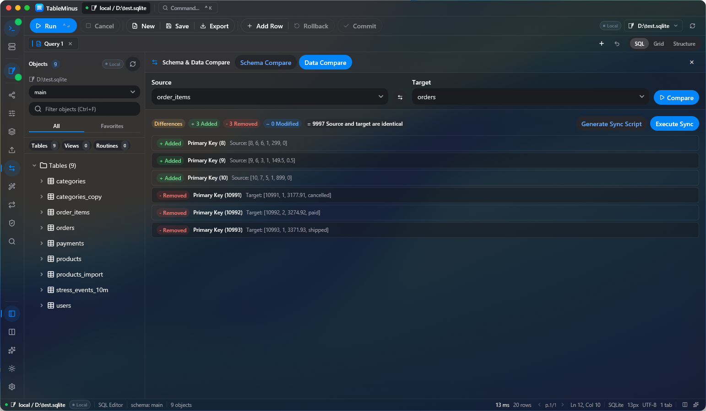

<div align="center">


# TableMinus

**基于 Rust 与 Direct3D 11 构建的 Windows 原生 SQL 与数据库工作台。**

[](https://github.com/williamcachamwri/TableMinus/actions/workflows/ci.yml)
[](https://github.com/williamcachamwri/TableMinus/actions/workflows/release.yml)
[](https://www.rust-lang.org/)
[](#概述)
[](#支持的数据库)
[](#概述)
[](#概述)
[](#下载与安装)
[](LICENSE-MIT)

[English](README.md) · [Tiếng Việt](README.vi.md) · [简体中文](README.zh-CN.md) · [日本語](README.ja.md) · [Español](README.es.md) · [Français](README.fr.md)

</div>

---

## 概述

TableMinus 是一款用 Rust 编写的 Windows 原生 SQL 与数据库工作台。界面通过 [HeroGPUI](https://github.com/williamcachamwri/TableMinus) 直接在 Direct3D 11 上渲染，底层基于开源的 [TablePro](https://github.com/TableProApp/TablePro) Rust 数据库内核，不依赖 Electron 或 JVM。

在 Windows 11 的 release 构建中，冷启动时间约为 `10 ms`（通过 `--smoke-startup` 加载全部 9 个驱动实测为 `9.21` 到 `10.11 ms`）；在 `100k`、`500k` 和 `1M` 行压力查询期间，进程内存占用稳定在 `~55 MB` 左右。在 `tableminus-e2e` SQLite 测试套件中，向数据网格加载 `100k` 行耗时 `24.43 ms`，滚动 `10k` 帧耗时 `0.432 ms`。

---

## 界面截图

### SQL 编辑器、实时图表与查询结果


### 虚拟化数据网格、列聚合统计与参数化筛选


### 交互式 ER 关系图、外键连线与 SVG 导出


### 数据导入向导（CSV、JSON、XLSX）与自动类型映射


### 架构与数据对比、差异汇总与同步脚本生成



### 模拟数据生成器（确定性种子与外键拓扑排序）


### 跨引擎数据传输与实时 DDL 预览


### 元数据全局搜索面板（Metadata Search）


### 仅发送 Schema 的 AI 抽屉（`Ctrl+Shift+A`）


---

## 支持的数据库

TableMinus 将 9 个数据库驱动直接编译进 `tableminus.exe`，无需额外配置 ODBC 驱动或插件：

| 数据库 | 驱动 Crate | 说明 |
| :--- | :--- | :--- |
| PostgreSQL | `tablepro-driver-postgres` | `tokio-postgres` + `deadpool`，支持 `COPY IN`、Schema 与 DDL 查看 |
| MySQL / MariaDB | `tablepro-driver-mysql` | 完整 SQL 方言与目录元数据支持 |
| SQLite | `tablepro-driver-sqlite` | 支持直接打开、拖拽或通过 CLI 加载 `.sqlite` / `.db` 本地文件 |
| DuckDB | `tablepro-driver-duckdb` | 内置 DuckDB 2.0，静态链接 `json` 与 `parquet` |
| Microsoft SQL Server | `tablepro-driver-mssql` | 纯 Rust TDS 8.0（`tiberius`），支持 TLS 与多结果集批处理 |
| ClickHouse | `tablepro-driver-clickhouse` | 通过 `hyper-rustls` 执行 HTTP/TLS 查询 |
| Cassandra / ScyllaDB | `tablepro-driver-cassandra` | 基于 `rustls` 的原生 CQL 驱动（`scylla`） |
| MongoDB | `tablepro-driver-mongodb` | 文档查询、BSON 3 映射与 DNS 种子列表解析 |
| Redis | `tablepro-driver-redis` | 基于异步 TLS/TCP 的键值查看与命令执行 |

连接层内置基于 `russh` 的进程内 SSH 隧道（`tablepro-ssh`，支持密码、私钥、口令弹窗与主机密钥校验）、基于 `rustls` 与 Windows 证书存储的 TLS（`Disable`、`Prefer`、`Require`、`VerifyCA`、`VerifyFull`，支持自定义 CA 与客户端证书/私钥）、安全模式策略（`Off`、`ConfirmWrites`、`ReadOnly`），以及通过 `tablepro-foreign-import` 从其他数据库客户端导入已保存的连接。

---

## 功能特性

### SQL 编辑器与数据网格

编辑器支持按方言区分的语法高亮（`PostgreSQL`、`MySQL`、`SQLite`、`MsSql` 等）、表/列/Schema/关键字与 SQL 子句（`FROM`、`JOIN`、`INTO`、`UPDATE`）自动补全、多光标编辑、已保存查询库、持久化查询历史，以及可选的 Vim 模式（`NORMAL`、`INSERT`、`VISUAL`、`COMMAND`）。

在数据网格中，可以通过停靠的 Row Inspector（`Ctrl+I`）查看行详情，切换 Structure、Columns、Indexes、Foreign Keys 与 DDL 标签页，固定前导列（最多占视口宽度的 2/3），调整或隐藏列，并叠加 11 种参数化过滤操作符（`=`、`!=`、`Contains`、`StartsWith`、`EndsWith`、`&lt;`、`&lt;=`、`&gt;`、`&gt;=`、`IS NULL`、`IS NOT NULL`）。单元格修改、插入行（`Alt+Insert`）和删除行（`Ctrl+Shift+Backspace`）会先暂存为批次，待确认后再执行 `Commit`（`Ctrl+Shift+S`）或 `Rollback`（`Ctrl+Shift+R`）。

通过 `Ctrl+Shift+E` 可将查询结果或数据表导出为 CSV（`.csv`）、JSON Array（`.json`）、JSON Lines（`.jsonl`）或 SQL `INSERT`（`.sql`），写入过程经由 `.part` 临时文件原子完成。`tablepro-core` 同样内置了 TSV、XML 与恒定内存占用的 XLSX 编码器。

### 安全与本地存储

数据库密码、SSH 密钥、AI API 密钥以及 MCP Bearer Token 均存储在 Windows 凭据管理器（`CredWriteW` / `CredReadW`）中，并在内存使用后通过 `zeroize` 擦除，不会以明文形式写入 JSON 配置文件或日志。连接在安全模式下可设为 `ConfirmWrites` 或 `ReadOnly`，确保 `UPDATE`、`DELETE`、`DROP` 等语句在执行前弹出确认或直接拦截。

### AI 助手与 MCP 服务

AI 侧边抽屉（`Ctrl+Shift+A`）可连接本地 Ollama（`http://127.0.0.1:11434/v1`）、任意兼容 OpenAI 接口的服务、OpenAI 或 Anthropic。发送给模型的仅包含 Schema 元数据（表名、列名、数据类型与 SQL 方言），表内的实际行数据不会离开本机。

针对外部编程代理与 IDE，`tablepro-mcp` 在本地回环地址 `127.0.0.1` 上运行 HTTP MCP 服务，通过 Windows 凭据管理器中的 Bearer Token 及对端校验进行保护，并提供 11 个工具：

- `list_connections`、`connect`、`list_databases`、`list_schemas`、`list_tables`、`describe_table`、`get_table_ddl`、`browse_table`、`count_rows`、`execute_query`、`export_data`

其中 `execute_query` 会严格遵循各个连接的 External Clients 与安全模式配置，任何写入语句执行前都必须在 TableMinus 界面内由用户确认。

### 主题、窗口材质与多语言

TableMinus 内置 14 套主题（`Dark`、`Light`、`High Contrast`、`Gaussian Glass Dark`、`Gaussian Glass Light`、`Tokyo Night`、`Dracula`、`Catppuccin Mocha`、`One Dark Pro`、`Nord`、`Monokai Pro`、`Gruvbox Dark`、`GitHub Light`、`Catppuccin Latte`）。界面主题与代码语法配色可独立搭配，也支持导入 VS Code 的 `.json` 配色主题。

在 Windows 11 上，主窗口支持 DWM `Gaussian Blur`、`Mica`、`Mica Alt` 与 `Opaque` 四种背景材质，同时所有浮动浮层保持完全不透明（`1.0` alpha）以确保文字清晰可读。减弱动态效果选项会读取系统的 `SPI_GETCLIENTAREAANIMATION` 设置，在系统关闭动画时跳过抽屉和弹窗过渡。所有界面文本、菜单、对话框、提示与驱动诊断信息均已本地化为 6 种语言：`en-US`、`vi-VN`、`zh-CN`、`ja-JP`、`es-ES` 与 `fr-FR`。

### 命令行用法

`tableminus.exe` 同时承担桌面启动器与脚本化 CLI（`tablepro-cli`）的角色。直接传入 `.sqlite`、`.db`、`.duckdb`、`.sql` 文件路径或连接 URL（`postgresql://...`）时，会通过 Named Pipe IPC 在当前运行窗口中打开（传入 `-n` / `--new-window` 可新建窗口）。

顶层参数：
- `--version`（`-V`）打印版本号并退出。
- `--help`（`-h`）打印 CLI 用法与参数说明。
- `--smoke-startup` 运行无界面启动耗时检查并校验全部 9 个驱动注册状态。

子命令包括：`open`、`query`、`connections`、`databases`、`schemas`、`tables`、`describe`、`export`、`status` 以及 `completion`（支持 `bash`、`zsh`、`fish`），配合 `--format`、`--read-only`、`--limit` 与 `--timeout` 参数使用。

```powershell
# 执行只读查询并以 JSON Lines 格式输出
.\target\release\tableminus.exe query -c Staging --read-only --format jsonl "SELECT id, email FROM users LIMIT 10"

# 查看数据表的 CREATE TABLE DDL
.\target\release\tableminus.exe describe -c Staging --ddl users
```

---

## 下载与安装

系统要求：**Windows 10 或 Windows 11（x64）**。预编译安装包发布在 [GitHub Releases](https://github.com/williamcachamwri/TableMinus/releases)：

- **安装程序（`TableMinus-win-Setup.exe`）**：安装到 `%LocalAppData%` 并创建开始菜单与桌面快捷方式，无需 UAC 管理员权限。内置 Velopack 后台增量更新，可在 **Settings -> About** 中配置。
- **便携版（`TableMinus-win-Portable.zip`）**：解压到任意目录即可直接运行 `tableminus.exe`，不会修改安装器状态。

每次发布均附带 `SHA256SUMS.txt`，可在 PowerShell 中校验文件哈希：

```powershell
Get-FileHash .\TableMinus-win-Setup.exe -Algorithm SHA256
```

---

## 快捷键

| 快捷键 | 功能 |
| :--- | :--- |
| `Ctrl+K` / `Ctrl+Shift+K` / `Ctrl+P` | 打开命令面板 |
| `Ctrl+Enter` / `F5` | 执行当前 SQL 查询 |
| `Ctrl+Shift+Enter` | 执行选中的 SQL 文本 |
| `Shift+Esc` | 取消正在运行的查询 |
| `Ctrl+S` | 保存查询到查询库 |
| `Ctrl+T` / `Ctrl+W` / `Ctrl+Shift+T` | 新建标签页 / 关闭标签页 / 重新打开已关闭标签页 |
| `Ctrl+Tab` / `Ctrl+Shift+Tab` | 下一个 / 上一个标签页 |
| `Ctrl+F` | 聚焦侧边栏对象过滤框 |
| `Ctrl+B` | 显示/隐藏对象侧边栏 |
| `Ctrl+I` | 显示/隐藏 Row Inspector |
| `Ctrl+Shift+A` | 显示/隐藏 AI 助手抽屉 |
| `Ctrl+Shift+O` | 打开连接库 |
| `Ctrl+,` | 打开设置 |
| `Ctrl+Shift+M` | 切换主题 |
| `Ctrl+Shift+S` / `Ctrl+Shift+R` | 提交（`Commit`） / 回滚（`Rollback`）暂存的网格修改 |
| `Alt+Insert` / `Ctrl+Shift+Backspace` | 新增行 / 删除网格中选中的行 |
| `Ctrl+Shift+E` | 导出查询结果或数据表 |
| `Esc` | 关闭当前弹窗或浮层 |

可在 SQL 编辑器工具栏开启 Vim 导航模式（支持 `NORMAL`、`INSERT`、`VISUAL` 及 `:` 命令）。

---

## 从源码构建

### 环境要求

- Windows 10 或 Windows 11（x64）
- 通过 [rustup](https://rustup.rs/) 安装的稳定版 Rust MSVC 工具链（`x86_64-pc-windows-msvc`，Rust `2024` Edition）
- Visual Studio C++ Build Tools 与 Windows SDK（用于 Win32、Direct3D 11 与内嵌 C 驱动编译）
- Windows PowerShell（串联多条命令时请使用 `;` 而非 `&&`）

> [!CAUTION]
> 请始终使用 `--release` 进行构建和测试。除非专门调试符号问题，否则不要对整个工作区运行未配置 profile 的 debug 版 `cargo build` 或 `cargo test`，因为全部 crate 与 9 个驱动在 `target\debug` 下生成的 PDB 文件会超过 140 GB。内存有限的机器请附带 `-j 1`。

### 构建与测试命令

```powershell
# 确认没有正在运行的 tableminus.exe 占用 target\release\tableminus.exe
Get-Process tableminus -ErrorAction SilentlyContinue

# 以 release 模式进行类型检查和编译
cargo check --release -j 1 -p tableminus-windows-app
cargo build --release -j 1 -p tableminus-windows-app

# 运行无界面启动检查并启动应用
.\target\release\tableminus.exe --smoke-startup
.\target\release\tableminus.exe
```

Release 测试套件：

```powershell
cargo test --release -j 1 -p tablepro-core filter
cargo test --release -j 1 -p tableminus-e2e --test startup_perf_e2e -- --nocapture
cargo test --release -j 1 -p tableminus-e2e --test sqlite_e2e -- --nocapture
```

### 工作区结构

| 路径 | 职责 |
| :--- | :--- |
| `core/crates/core` | `tablepro-core`：查询模型、过滤条件、SQL 方言与导出编码器 |
| `core/crates/session` | `tablepro-session`：活跃会话、连接池与事务管理 |
| `core/crates/cli` | `tablepro-cli`：CLI 子命令与无界面运行器 |
| `core/crates/mcp` | `tablepro-mcp`：带 Token 认证的本地回环 MCP HTTP 服务 |
| `core/crates/ai` | `tablepro-ai`：仅传 Schema 的 Ollama、OpenAI 与 Anthropic 客户端 |
| `core/crates/ssh` | `tablepro-ssh`：基于 `russh` 的进程内 SSH 隧道 |
| `core/crates/net` | `tablepro-net`：`rustls` TLS 与系统证书校验 |
| `core/crates/storage` | `tablepro-storage`：已保存连接、查询库与历史记录 |
| `core/crates/foreign-import` | `tablepro-foreign-import`：从其他数据库客户端导入连接 |
| `core/crates/account` | `tablepro-account`：账号与凭据 trait |
| `core/crates/drivers/*` | 9 个数据库驱动（`postgres`、`mysql`、`sqlite`、`duckdb`、`mssql`、`clickhouse`、`cassandra`、`mongodb`、`redis`） |
| `crates/tableminus-gfx` | 矢量图标与数据库引擎图标 |
| `crates/tableminus-state` | 编辑器状态、自动补全、网格模型、标签页与 14 套内置主题 |
| `crates/tableminus-services` | 异步 Tokio 运行时、会话/AI/MCP 调度与多语言诊断信息 |
| `crates/tableminus-windows-platform` | 设置 JSON 持久化、Win32 凭据管理器、DWM 与减弱动态辅助 |
| `crates/tableminus-windows-app` | HeroGPUI（Direct3D 11）桌面应用、Velopack 更新器与 6 种语言包 |
| `crates/tableminus-e2e` | SQLite、DuckDB、启动耗时与网格渲染端到端基准测试 |

---

## 参与贡献与开源协议

欢迎提交 Pull Request、问题反馈或翻译修正。构建规范与 GPUI 注意事项请参阅 [CONTRIBUTING.md](CONTRIBUTING.md)，版本更新记录见 [CHANGELOG.md](CHANGELOG.md)，行为准则见 [CODE_OF_CONDUCT.md](CODE_OF_CONDUCT.md)，安全漏洞请按 [SECURITY.md](SECURITY.md) 指引私下反馈。

TableMinus 采用 [LICENSE](LICENSE)（GNU Affero General Public License v3.0）与 [LICENSE-MIT](LICENSE-MIT)（MIT，保留对上游内核 [TableProApp/TablePro](https://github.com/TableProApp/TablePro) 的署名）双协议授权。
