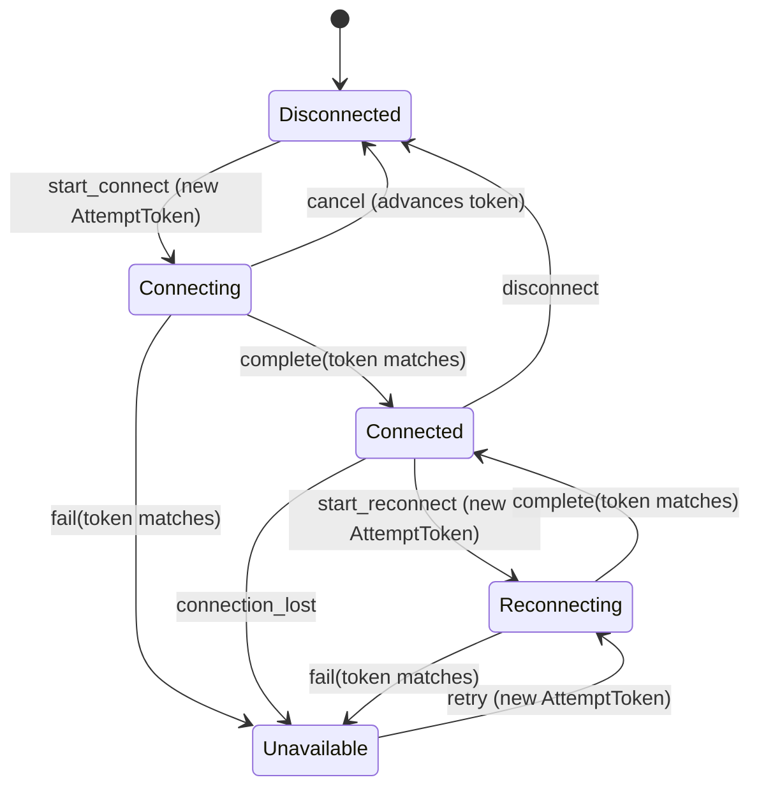

# DataForge State Machines

All UI state machines live in `crates/dataforge-state` as pure-Rust, deterministic, headless-testable models.

## 1. `ConnectionWindowPhaseMachine` (`connection_window.rs`)

Manages the lifecycle of each connection workspace (`WorkspaceId`) inside a window:

- **`AttemptToken` Fencing**: Every connect/reconnect increments a monotonic `AttemptToken(u64)`. Cancelling updates the phase immediately and invalidates prior tokens so late driver callbacks cannot mutate state.
- **Inline `ConnectionUnavailableView`**: Failures render inline inside the workspace pane (`WorkspacePaneKind::UnavailableInline`) with `summary`, optional `detail`, `can_retry`, and `is_auth_failure` — never as modal alert dialogs.
- **Close & Safe Mode Guards**: `CloseDecision` checks `SessionLiveness` and open-transaction state before closing a workspace or window.

## 2. `DataGridModel` (`data_grid.rs`)

Implements a 3-layer grid model separating stable data identity, display layout, and pending edits:

- **Stable Identity**: `RowID(u64)` and `DataGridColumnID(u64)` remain invariant across sorts, filters, and column reordering.
- **Frozen Leading Columns (`DataGridColumnSet`)**: Leading columns (`DataGridPane::Frozen`) are capped at `MAXIMUM_FROZEN_SHARE = 2.0 / 3.0` of the viewport width; column widths clamp to `[MIN_COLUMN_WIDTH (48.0), MAX_COLUMN_WIDTH (1200.0)]`. Table index `0` in both panes is reserved for `PaneColumnSlot::RowNumbers`.
- **Selection (`GridSelectionReducer`)**: Pure reducer supporting single-cell, range, row, and column selection modes (`GridSelectionMode`).
- **Sorting & Paging**: `HeaderSortCycle` cycles `None -> Ascending -> Descending -> None`; `TableQueryPage` tracks paged `table_query` windows and total row counts.
- **Batched Edits (`TableEdits`)**: Tracks cell edits (`DataGridCellEdit`), inserts, and deletes with undo batches (`EditUndoBatch`) until committed or rolled back.
- **Filter Bar & Exports**: `FilterBarState` manages active filter predicates; `GridExportFormat` supports CSV, JSON, and SQL output.

## 3. SQL Editor State (`editor.rs`)

- **Height-Balanced `Rope`**: Persistent balanced tree with `MAX_LEAF_CHARS = 2048`, tracking `chars`, `utf16`, and `newlines` per node for O(log N) line/column and UTF-16 offset mapping (matching DirectWrite `IDWriteTextLayout` UTF-16 indices).
- **Undo/Redo (`UndoHistory`)**: Groups `TextEdit` operations into `UndoGroup` batches with bottom-up multi-caret offset adjustment.
- **Incremental Highlighting (`IncrementalLineHighlighter`)**: Produces `Utf16SyntaxSpan` tokens per line so only dirty lines are re-tokenized.
- **Schema Autocomplete (`AutocompleteState`)**: Ranks `SchemaCompletionItem` candidates (`SchemaCompletionKind`) against the current identifier prefix.
- **Vim Mode (`VimState`)**: Modal state machine (`VimMode`, `VimOperator`, `VimMotion`, `VimAction`) for Normal/Insert/Visual editing.
- **Split Panes & Results**: `SplitPaneLayoutPolicy` and `EditorSplitNode` manage horizontal/vertical editor splits; `RunEventAccumulator` collects streaming `ResultEvent`s into `AccumulatedResultSet`s alongside `QueryHistoryModel`.

## 4. Tabs, Library, and Themes (`tabs.rs`, `library.rs`, `theme.rs`)

- **Tab Strip (`TabStripModel`)**: Enforces `Ctrl+W` precedence (`CloseActionResult`: close active tab first, close window only when no tabs remain), maintains a `ClosedTabEntry` stack for `Ctrl+Shift+T` (`ReopenClosedTab`), and coordinates `CrashSafeTabPersistence` + `SessionRestorePlanner` across restarts.
- **Connections Library (`ConnectionsLibraryModel`)**: Organizes `LibraryConnection` and `LibraryGroup` entries into `LibrarySection` outline rows with drag-and-drop reordering, inline `RenameSession`, and `ForeignImportReport` integration.
- **Themes (`ThemeResolver`, `VsCodeThemeImporter`)**: Resolves `ThemeSlot` colors across `ThemeScope` and `ThemeAppearance` (`Light` / `Dark`) with deterministic fallbacks, and imports VS Code JSON color/token themes via `ThemeFileFormat`.
