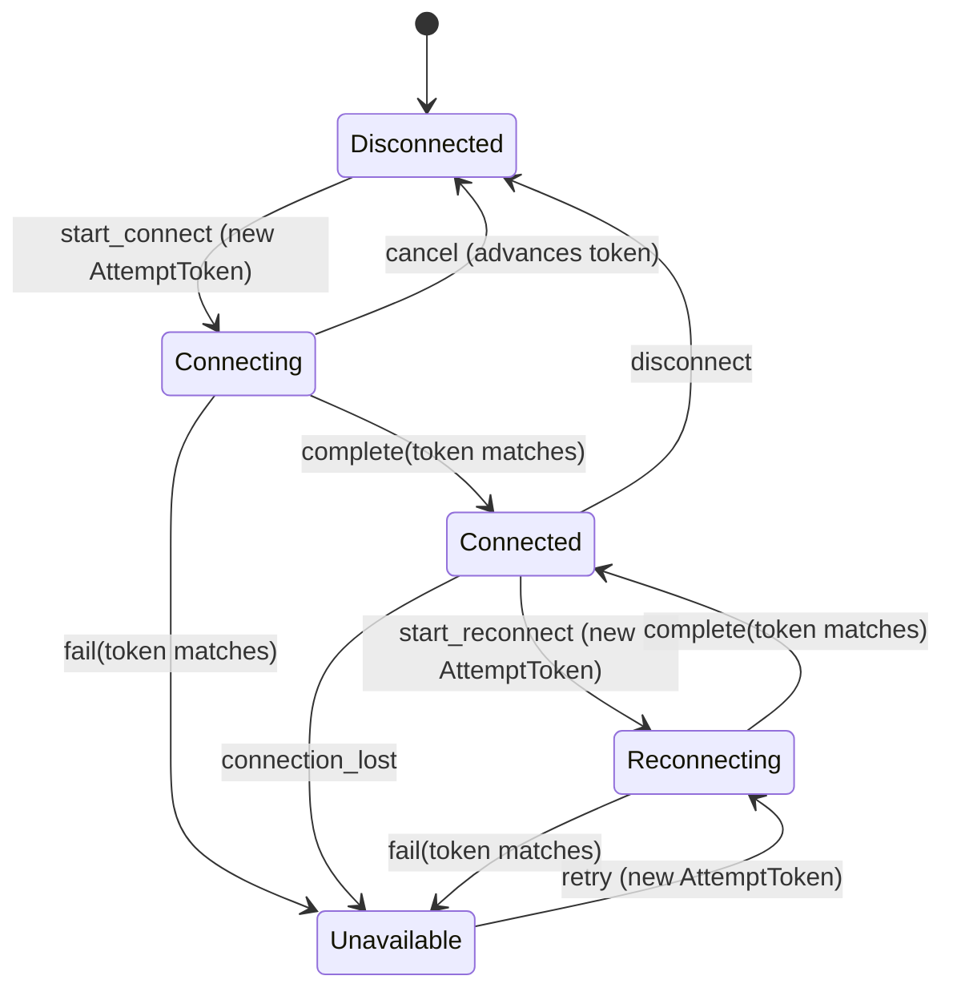

# DataForge State Machines

All UI state machines live in `crates/dataforge-state` as pure-Rust, deterministic, headless-testable models.

## 1. `ConnectionWindowPhaseMachine` (`connection_window.rs`)

Manages the lifecycle of each connection workspace (`WorkspaceId`) inside a window:

- **`AttemptToken` Fencing**: Every connect/reconnect increments a monotonic `AttemptToken(u64)`. Cancelling updates the phase immediately and invalidates prior tokens so late driver callbacks cannot mutate state.
- **Inline `ConnectionUnavailableView`**: Failures render inline inside the workspace pane (`WorkspacePaneKind::UnavailableInline`) with `summary`, optional `detail`, `can_retry`, and `is_auth_failure` — never as modal alert dialogs.
- **Close & Safe Mode Guards**: `CloseDecision` checks `SessionLiveness` and open-transaction state before closing a workspace or window.
