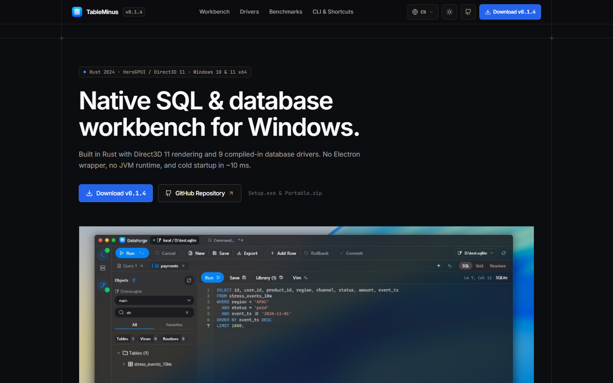
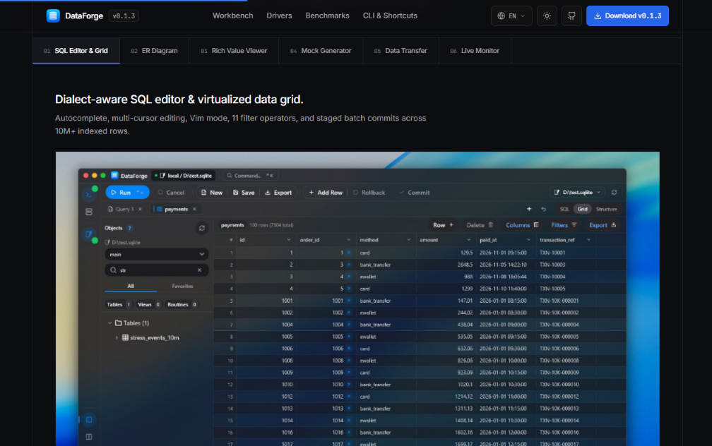
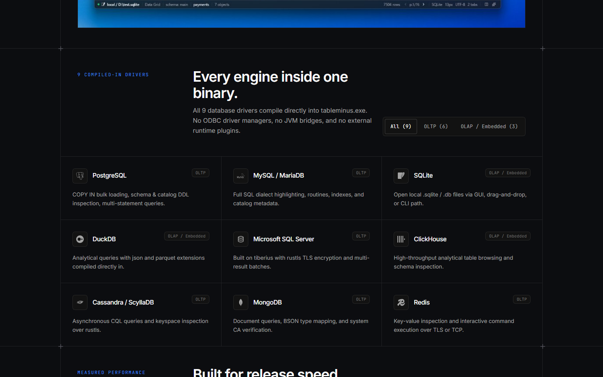
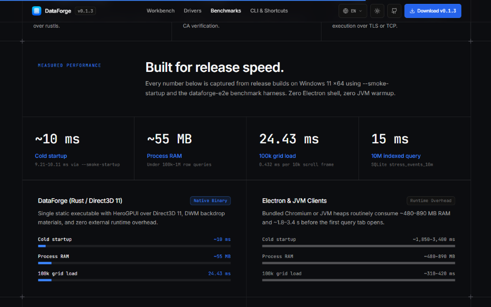

# DataForge Web Showcase

Official product showcase and landing site for **DataForge** — the native Windows SQL & database workbench written in Rust with HeroGPUI (Direct3D 11).

Designed with a **Vercel-style Technical Grid** architecture: full-bleed `1px` horizontal section bands, continuous centered `max-w-6xl` vertical rails, `11px` 4-corner `+` crosshairs at rail intersections, and `.cell-grid` `1px` dividers — with **zero** bloated code clutter or AI-slop gradients.

---

## Desktop Previews (`1440×900`)

### Hero & Technical Grid Frame


### Interactive Workbench Showcase


### Compiled-In Driver Matrix


### Native Benchmarks & Architecture Comparison


---

## Key Capabilities

- **Dynamic GitHub Release Resolution (`src/lib/release.ts`)**
  - Automatically fetches the latest release tag and installer assets (`Setup.exe`, `Portable.zip`) from `williamcachamwri/DataForge` on build, with graceful offline fallback.
- **6-Locale Internationalization (`src/i18n/translations.ts`)**
  - Full UI translation parity across **English (`en`)**, **Tiếng Việt (`vi`)**, **简体中文 (`zh-CN`)**, **日本語 (`ja`)**, **Español (`es`)**, and **Français (`fr`)** with `localStorage` persistence.
- **Dark & Light Mode (`src/styles/global.css`, `src/layouts/Layout.astro`)**
  - Inline `<head>` script prevents FOUC on initial paint; navbar toggle switches cleanly between `#0C0D10` dark technical canvas and `#FAFAFA` light canvas.
- **Interactive Workbench Tour (`src/components/WorkbenchShowcase.astro`)**
  - Six focused tabs covering **SQL Editor & Grid**, **ER Diagram**, **Rich Value Viewer**, **Mock Data Generator**, **Cross-Engine Transfer**, and **Live Server Monitor**.
- **9-Engine Driver Matrix (`src/components/DriverMatrix.astro`)**
  - Interactive category filters (`All`, `OLTP`, `OLAP / Embedded`) for PostgreSQL, MySQL, SQLite, SQL Server, DuckDB, ClickHouse, MongoDB, Redis, and Cassandra with monochrome SVG logos (`simple-icons`).
- **Smooth Motion & Scroll (`src/scripts/motion.ts`)**
  - Lenis smooth scrolling paired with GSAP choreography, `lucide-astro` UI icons, and `prefers-reduced-motion` support.

---

## Project Structure

```text
web/
├── docs/                        # Desktop preview screenshots for documentation
├── public/
│   └── images/                  # Real DataForge application screenshots
├── src/
│   ├── components/
│   │   ├── BenchmarksSection.astro
│   │   ├── CliAndShortcuts.astro
│   │   ├── DriverMatrix.astro
│   │   ├── Footer.astro
│   │   ├── Navbar.astro
│   │   ├── SectionBand.astro    # Full-bleed band + vertical rails + 4-corner '+' crosshairs
│   │   └── WorkbenchShowcase.astro
│   ├── i18n/
│   │   └── translations.ts      # 6-locale dictionary
│   ├── layouts/
│   │   └── Layout.astro         # Theme bootstrap, Lenis, font & metadata setup
│   ├── lib/
│   │   └── release.ts           # GitHub Releases API tag & download URL resolver
│   ├── pages/
│   │   └── index.astro          # Main landing page
│   ├── scripts/
│   │   └── motion.ts            # GSAP + Lenis + interactive tab/filter controllers
│   └── styles/
│       └── global.css           # Semantic CSS tokens, .grid-band, .cell-grid, .grid-crosshair
├── astro.config.mjs
├── package.json
└── tsconfig.json
```

---

## Local Development & Verification

### Prerequisites

- **Node.js** 18+ and **npm**

### Commands

```powershell
# Install dependencies
cd web
npm install

# Start local dev server (http://localhost:4321)
npm run dev

# TypeScript check + production build
npx tsc --noEmit
npm run build

# Preview production bundle locally
npm run preview -- --host 127.0.0.1 --port 4321
```
